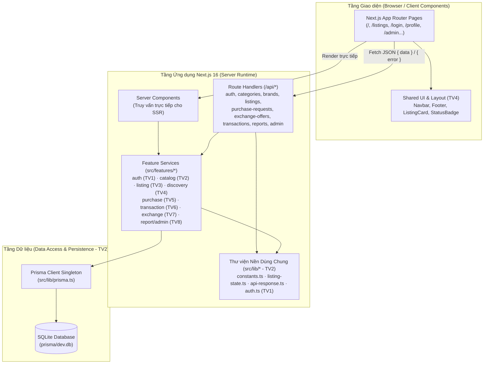
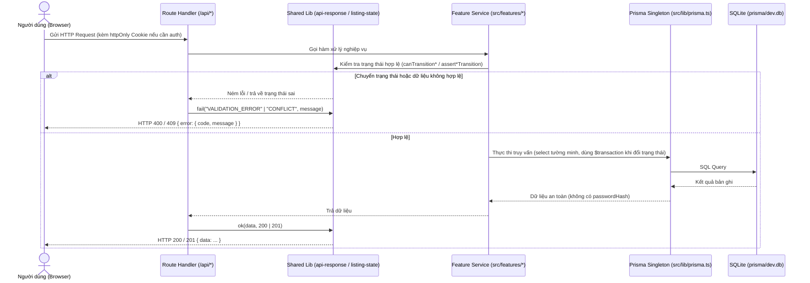

# Sơ đồ Kiến trúc Hệ thống — ElectroSwap C2C

> **Tác giả:** TV2 — System / DB Architect · **Cập nhật:** Sprint 1  
> **Stack:** Next.js 16 (App Router) · TypeScript (`strict: true`) · Tailwind CSS v4 · Prisma 6 · SQLite

---

## 1. SƠ ĐỒ KIẾN TRÚC TỔNG THỂ (LAYERED ARCHITECTURE)

---

## 2. LUỒNG XỬ LÝ REQUEST CHUẨN (SEQUENCE DIAGRAM)

---

## 3. NGUYÊN TẮC KIẾN TRÚC BẮT BUỘC

1. **Một kết nối Prisma duy nhất (`src/lib/prisma.ts`):** Mọi module bắt buộc `import { prisma } from "@/lib/prisma"`, không khởi tạo `new PrismaClient()` ở nơi khác để tránh khóa file SQLite khi Next.js hot-reload.
2. **State Machine tập trung (`src/lib/constants.ts` & `src/lib/listing-state.ts`):** Do SQLite không hỗ trợ `enum`, mọi giá trị trạng thái và bảng chuyển trạng thái của `Listing`, `PurchaseRequest`, `ExchangeOffer`, `Transaction` được kiểm soát tập trung tại tầng `src/lib/`.
3. **Chuẩn hóa phản hồi API (`src/lib/api-response.ts`):** Toàn bộ Route Handler trả về đúng cấu trúc `{ data }` hoặc `{ error: { code, message } }`.
4. **Phân vùng sở hữu theo chiều dọc (Vertical Slice per Member):** Mỗi thành viên sở hữu trọn vẹn `src/features/<module>`, `src/app/api/<module>`, trang UI tương ứng và file `tests/<module>.test.ts` để tránh xung đột Git.
