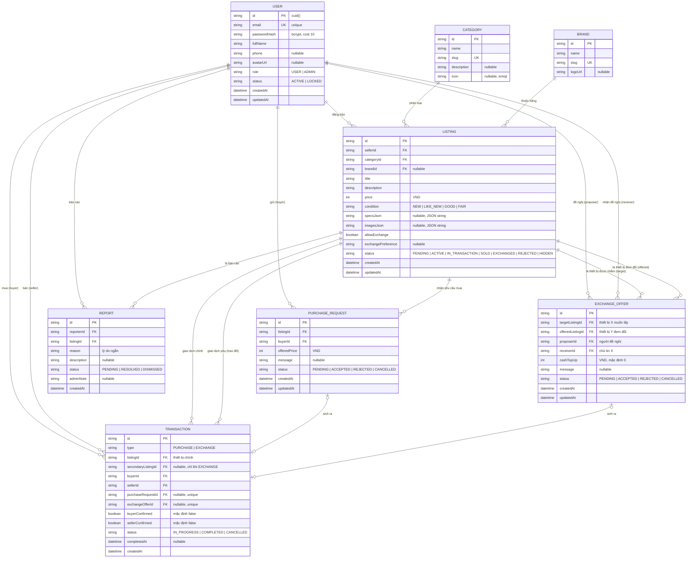
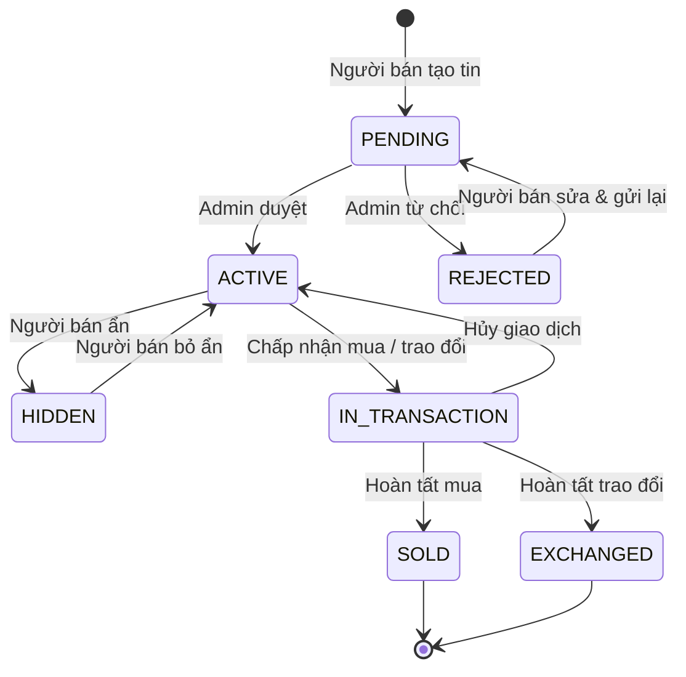
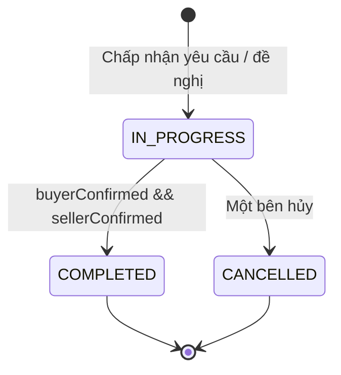

# ERD — Electronics Trading & Exchange Marketplace

> **Tác giả:** TV2 — System / DB Architect · **Cập nhật:** Sprint 1
> **Nguồn:** `prisma/schema.prisma` · **DBMS:** SQLite (qua Prisma)
>
> File này là **nguồn tham chiếu chính** cho mọi thành viên. Nếu ERD và
> `schema.prisma` khác nhau, **schema.prisma là đúng** — báo TV2 để cập nhật.

---

## 1. SƠ ĐỒ ERD



---

## 2. QUAN HỆ CHI TIẾT

| # | Quan hệ | Cardinality | Ý nghĩa nghiệp vụ |
|---|---|---|---|
| 1 | `User` → `Listing` | 1 : N | Một người bán nhiều tin |
| 2 | `Category` → `Listing` | 1 : N | Danh mục chứa nhiều tin |
| 3 | `Brand` → `Listing` | 1 : N | Thương hiệu, **nullable** cho linh kiện vô danh |
| 4 | `User` → `PurchaseRequest` | 1 : N | Người mua gửi nhiều yêu cầu |
| 5 | `Listing` → `PurchaseRequest` | 1 : N | Một tin nhận nhiều yêu cầu (chỉ 1 được chấp nhận) |
| 6 | `User` → `ExchangeOffer` (proposer) | 1 : N | Người đề nghị trao đổi |
| 7 | `User` → `ExchangeOffer` (receiver) | 1 : N | Chủ tin nhận đề nghị |
| 8 | `Listing` → `ExchangeOffer` (target) | 1 : N | Thiết bị X được nhắm tới |
| 9 | `Listing` → `ExchangeOffer` (offered) | 1 : N | Thiết bị Y đem đi đổi |
| 10 | `PurchaseRequest` ↔ `Transaction` | 1 : 0..1 | Yêu cầu được chấp nhận sinh 1 giao dịch |
| 11 | `ExchangeOffer` ↔ `Transaction` | 1 : 0..1 | Đề nghị được chấp nhận sinh 1 giao dịch |
| 12 | `Listing` → `Transaction` (chính / phụ) | 1 : N | Trao đổi dùng tới **2** listing |
| 13 | `User` → `Transaction` (buyer / seller) | 1 : N | Lịch sử giao dịch 2 chiều |
| 14 | `User` → `Report` | 1 : N | Người dùng báo cáo vi phạm |
| 15 | `Listing` → `Report` | 1 : N | Một tin có thể bị báo cáo nhiều lần |

### Vì sao `Transaction` có 2 cột listing?

| Loại giao dịch | `listingId` | `secondaryListingId` |
|---|---|---|
| `PURCHASE` | thiết bị được mua | `NULL` |
| `EXCHANGE` | thiết bị X (của người nhận đề nghị) | thiết bị Y (của người đề nghị) |

Thiết kế này cho phép dùng **một bảng duy nhất** cho cả mua bán và trao đổi,
đồng thời giữ được ràng buộc "một thiết bị chỉ nằm trong 1 giao dịch".

---

## 3. RÀNG BUỘC DỮ LIỆU (DB-LEVEL)

| Ràng buộc | Cách hiện thực | Ghi chú |
|---|---|---|
| Email không trùng | `UNIQUE(email)` | Prisma `@unique` |
| Slug danh mục/hãng không trùng | `UNIQUE(slug)` | Prisma `@unique` |
| Mỗi yêu cầu mua sinh tối đa 1 giao dịch | `UNIQUE(purchaseRequestId)` | Prisma `@unique` |
| Mỗi đề nghị trao đổi sinh tối đa 1 giao dịch | `UNIQUE(exchangeOfferId)` | Prisma `@unique` |
| Khóa ngoại hợp lệ | FK của Prisma | Bật `PRAGMA foreign_keys` mặc định |
| Không trùng listing khi chốt giao dịch | **Logic nghiệp vụ** (transaction + kiểm tra `IN_TRANSACTION`) | SQLite không có partial unique index dễ dùng với Prisma `db push` |

⚠️ **Điểm cần lưu ý:** SQLite không hỗ trợ enum và không cho Prisma tạo
`partial unique index` qua schema. Vì vậy:

- **Giá trị trạng thái** chỉ được validate ở tầng ứng dụng
  (`src/lib/constants.ts` + `src/lib/listing-state.ts`).
- **Chống double-booking** (1 listing nằm trong 2 giao dịch) phải được kiểm tra
  trong **cùng một transaction Prisma** khi tạo `Transaction`:

```ts
await prisma.$transaction(async (tx) => {
  const listing = await tx.listing.findUniqueOrThrow({ where: { id: listingId } });
  if (listing.status !== "ACTIVE") {
    throw new Error("Tin đăng không ở trạng thái ACTIVE");
  }
  await tx.listing.update({
    where: { id: listingId },
    data: { status: "IN_TRANSACTION" },
  });
  return tx.transaction.create({ /* ... */ });
});
```

> Đây là quy tắc **bắt buộc** với TV6 (mua) và TV7 (trao đổi).

---

## 4. SƠ ĐỒ TRẠNG THÁI (tham chiếu)

### 4.1 Listing



### 4.2 Transaction



---

## 5. DỮ LIỆU SEED

| Loại | Số lượng | Ghi chú |
|---|---|---|
| User | 4 | 1 ADMIN + 3 USER, mật khẩu `123456` |
| Category | 5 | Điện thoại, Laptop, Máy tính bảng, Tai nghe & Đồng hồ, Linh kiện & Phụ kiện |
| Brand | 6 | Apple, Samsung, Dell, Asus, Sony, Xiaomi |
| Listing | 11 | 9 `ACTIVE`, 1 `PENDING`, 1 `SOLD`; 6 tin cho phép trao đổi; 1 tin không có brand |

Danh sách chạy: `npm run db:seed` (idempotent — chạy nhiều lần không nhân đôi).

---

## 6. GHI CHÚ KỸ THUẬT

1. **Tiền tệ:** `Int`, đơn vị **VND**. Không dùng `Float` để tránh sai số.
2. **Ngày giờ:** `DateTime` (Prisma lưu dạng ISO-8601 trong SQLite).
3. **JSON:** `specsJson` / `imagesJson` là `String` chứa JSON — phải
   `JSON.parse` khi đọc. Helper gợi ý (TV3/TV4 có thể tạo):
   ```ts
   const specs = JSON.parse(listing.specsJson ?? "{}") as Record<string, string>;
   ```
4. **Xoá mềm:** `Listing` dùng `HIDDEN`, `User` dùng `LOCKED` — **không** xoá cứng
   bản ghi đã phát sinh giao dịch.
5. **Index:** đã đánh cho các cột lọc phổ biến (`status`, `categoryId`,
   `brandId`, `sellerId`, `buyerId`) để tìm kiếm không quét toàn bảng.
