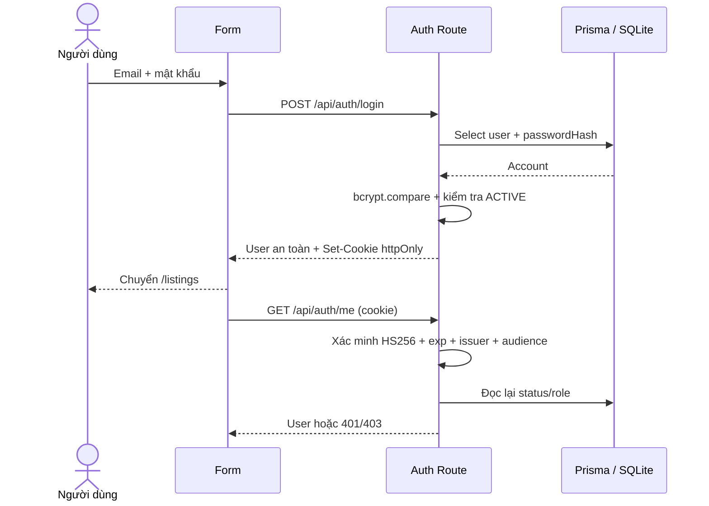

# SRS — Module Auth & Hồ sơ cá nhân (TV1)

Phiên bản 1.0 · Sprint 1 · TV1: PM / Scrum Master, Auth Owner.

## 1. Mục tiêu

Xác thực cho ElectroSwap C2C chạy local bằng Next.js App Router, Prisma 6 và SQLite.
Sprint 1 triển khai đăng ký, đăng nhập, đăng xuất, đọc người dùng hiện tại và helper phân quyền.
Hồ sơ có thể xem thông tin phiên và đăng xuất; cập nhật hồ sơ, middleware bảo vệ toàn bộ route
và đồng bộ Navbar thuộc Sprint 2. Không thay schema, UI dùng chung hay module khác.

Actor toàn hệ thống: Guest, Registered User (đồng thời mua/bán/trao đổi), Admin.
Phạm vi sản phẩm gồm tài khoản, danh mục, tin đăng, khám phá, yêu cầu mua, trao đổi,
giao dịch và quản trị/báo cáo. Không triển khai thanh toán, vận chuyển, ký quỹ, chat,
rating, đấu giá hoặc AI gợi ý; không deploy và CI/CD.

## 2. Actor liên quan

| Actor | Quyền |
|---|---|
| Guest | Đăng ký, đăng nhập |
| User đang ACTIVE | Đọc hồ sơ phiên, đăng xuất, sử dụng các module cần đăng nhập |
| Admin đang ACTIVE | Có thêm quyền qua requireAdmin ở phía server |
| User LOCKED | Không đăng nhập hoặc sử dụng phiên đã cấp |

## 3. Use Case

### UC-AUTH-01: Đăng ký

- Actor: Guest.
- Tiền điều kiện: DB được khởi tạo; JWT_SECRET có ít nhất 32 byte.
- Luồng chính: nhập email, mật khẩu, họ tên, phone tùy chọn → POST register →
  chuẩn hóa email (trim/lowercase), kiểm tra đầu vào → hash bcrypt cost 10 →
  tạo User USER/ACTIVE → cấp cookie → trả 201 và user an toàn → chuyển /listings.
- Ngoại lệ: email trùng 409 CONFLICT; JSON/đầu vào sai 400 VALIDATION_ERROR;
  origin khác 403 FORBIDDEN; DB/cấu hình lỗi 500 INTERNAL_ERROR.
- Hậu điều kiện: tài khoản và phiên được tạo; không nhận role/status từ client.

### UC-AUTH-02: Đăng nhập

- Actor: Guest.
- Tiền điều kiện: tài khoản tồn tại.
- Luồng chính: nhập email/password → POST login → bcrypt.compare → kiểm tra ACTIVE →
  cấp cookie và trả user → chuyển /listings.
- Ngoại lệ: email không tồn tại hoặc password sai cùng trả 401 UNAUTHENTICATED;
  password đúng nhưng tài khoản LOCKED trả 403 FORBIDDEN; đầu vào sai trả 400.
- Hậu điều kiện: cookie mới thay cookie cũ. Cho phép mật khẩu demo 123456 khi đăng nhập;
  quy tắc tối thiểu 8 ký tự áp dụng cho đăng ký mới.

### UC-AUTH-03: Đăng xuất

- Actor: User hoặc Guest.
- Tiền điều kiện: không bắt buộc có phiên.
- Luồng chính: POST logout → cookie rỗng, Max-Age=0, Expires ở quá khứ, cùng Path=/ → 200.
- Ngoại lệ: origin khác trả 403.
- Hậu điều kiện: trình duyệt bỏ cookie; gọi lại vẫn thành công.
- Giới hạn: JWT stateless; bản sao token cũ vẫn hợp lệ đến hết hạn. Chưa có kho thu hồi
  token hoặc đăng xuất toàn bộ thiết bị trong phạm vi Sprint 1.

### UC-AUTH-04: Xem & cập nhật hồ sơ

- Actor: User/Admin ACTIVE.
- Tiền điều kiện: có JWT hợp lệ.
- Luồng chính Sprint 1: GET me → xác minh JWT → đọc lại user từ DB → trả user an toàn;
  trang /profile hiển thị thông tin và nút đăng xuất.
- Ngoại lệ: thiếu cookie, JWT sai/hết hạn, user không tồn tại trả 401; LOCKED trả 403.
- Hậu điều kiện: không thay đổi dữ liệu.
- Sprint 2: cập nhật fullName, phone, avatarUrl; PATCH /api/profile chưa được triển khai.

## 4. Yêu cầu chức năng (FR)

| Mã | Nội dung |
|---|---|
| FR-1.01 | POST register nhận email, password, fullName, phone?; tạo USER/ACTIVE |
| FR-1.02 | POST login kiểm tra bcrypt và trạng thái tài khoản |
| FR-1.03 | POST logout xóa cookie, không yêu cầu phiên |
| FR-1.04 | GET me trả user hiện tại; guard requireUser/requireAdmin dùng lại cho module khác |
| FR-1.05 | /login, /register có validation, loading, lỗi API và liên kết chuyển form |
| FR-1.06 | /login có bốn tài khoản demo để điền nhanh |
| FR-1.07 | /profile hiển thị tài khoản hiện tại và nút đăng xuất |

API thành công: `{ data: user }`, riêng logout `{ data: { message } }`.
Lỗi: `{ error: { code, message } }`; code theo AGENTS.md.
User gồm id, email, fullName, phone, avatarUrl, role, status, createdAt, updatedAt.
Không trả passwordHash hoặc JWT trong JSON.

## 5. Yêu cầu phi chức năng (NFR)

- TypeScript strict; không thêm dependency; chỉ import Prisma singleton và UI của TV4.
- JWT HS256 có sub, iss, aud, iat, exp; tuổi phiên 7 ngày; so chữ ký bằng timingSafeEqual.
- Cookie electroswap_session: httpOnly, SameSite=Lax, Path=/, Max-Age=604800;
  Secure=false khi dev local, true khi NODE_ENV=production.
- JWT_SECRET lấy từ .env, không hardcode hoặc commit. Giá trị mẫu trong .env.example
  cần được thay bằng secret ngẫu nhiên ít nhất 32 byte trước khi chạy Auth.
- Không lưu token trong localStorage/sessionStorage; response Auth có Cache-Control: no-store.
- POST Auth kiểm tra Origin khi có và chặn Sec-Fetch-Site=cross-site.
- Đọc status/role từ DB mỗi lần dùng phiên để khóa tài khoản/đổi quyền có hiệu lực ngay.
- Giới hạn Sprint 1: chưa có rate limit hoặc thu hồi JWT riêng lẻ; không tuyên bố đã hỗ trợ.

## 6. Ràng buộc dữ liệu & trạng thái

- Email được trim/lowercase, tối đa 254 ký tự, phải có dạng email; unique do DB bảo đảm.
- fullName sau trim dài 2–100 ký tự.
- Mật khẩu đăng ký ít nhất 8 ký tự, tối đa 72 byte UTF-8 để tránh bcrypt cắt ngầm;
  không trim mật khẩu. Login chấp nhận mật khẩu demo 6 ký tự.
- phone tùy chọn, bỏ trống thành null; nếu nhập cần 8–15 chữ số thực,
  tổng độ dài tối đa 20 ký tự, chỉ cho phép số và dấu + đầu chuỗi, (), khoảng trắng, -.
  Form và API dùng chung quy tắc; chuỗi chỉ có dấu phân cách bị từ chối.
- Không cho client tự gán role hoặc status. Không thay schema User.

## 7. Tiêu chí chấp nhận

- Đăng ký hợp lệ: 201, password lưu dạng bcrypt cost 10, user USER/ACTIVE và cookie an toàn.
- Trùng email: 409; mật khẩu yếu/quá 72 byte, email/họ tên/phone sai, JSON hỏng: 400.
- Đăng nhập đúng: 200; sai thông tin: 401; LOCKED: 403.
- me có cookie: đúng user và không lộ hash; thiếu/giả/hết hạn cookie: 401.
- User không được requireAdmin; thay quyền/khóa trong DB ảnh hưởng phiên đã cấp.
- Logout: cookie hết hạn; trình duyệt sau logout gọi me nhận 401.
- POST khác origin: 403. Không có token hoặc passwordHash trong JSON.
- npm run check và npm run build phải pass trước khi sẵn sàng merge.

## 8. Truy vết

| Yêu cầu | File | Kiểm chứng |
|---|---|---|
| FR-1.01 | src/app/api/auth/register/route.ts, validation.ts | tests/auth.test.ts: đăng ký, trùng, validation |
| FR-1.02 | src/app/api/auth/login/route.ts | tests/auth.test.ts: đúng/sai mật khẩu, LOCKED |
| FR-1.03 | src/app/api/auth/logout/route.ts | tests/auth.test.ts: logout |
| FR-1.04 | src/lib/auth.ts, src/app/api/auth/me/route.ts | tests/auth.test.ts: JWT, me, guard |
| FR-1.05–06 | src/features/auth/components/AuthForm.tsx, app/(auth) | Chạy thử /login, /register |
| FR-1.07 | src/app/profile/page.tsx | Chạy thử /profile và logout |

## 9. Điểm cần phối hợp

- Chưa có develop trên remote lúc bắt đầu: nhánh feat/tv1-auth-sprint1 lấy từ origin/main;
  develop được khởi tạo từ cùng baseline main để PR tuân thủ luồng tích hợp của nhóm.
- docs/PROJECT-WORKBOOK.md và docs/ai/task-cards/sprint-1.md mô tả kiến trúc cũ;
  triển khai theo AGENTS.md, MEMBER-GUIDEBOOK.md, agileplan.tsv và schema hiện tại.
- TV1 đã soạn [overview.md](overview.md) theo nhiệm vụ MEMBER-GUIDEBOOK;
  TV3 review và tiếp tục chủ trì tổng hợp SRS. Không sửa bảng phân công hay mục lục của TV3.
- Navbar thuộc TV4: cần TV4 tích hợp GET /api/auth/me và POST logout trong Sprint 2.
- PATCH /api/profile được yêu cầu ở Sprint 2 nhưng chưa có trong phân vùng write của TV1
  ở AGENTS.md; cần thống nhất phân vùng trước khi triển khai endpoint đó.
