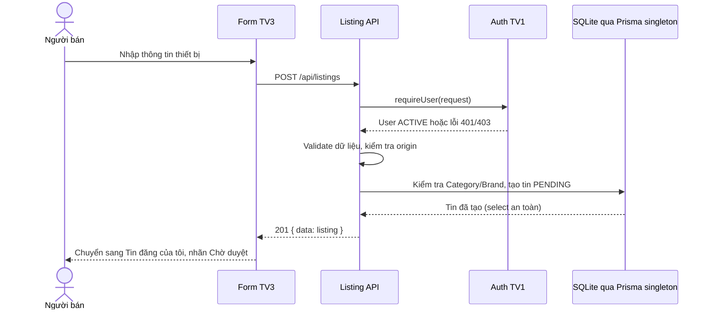
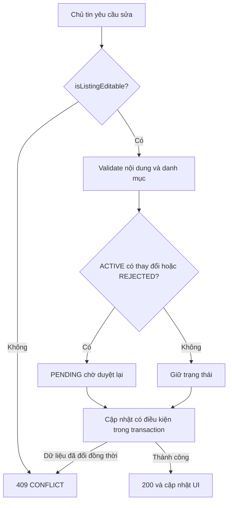

# SRS — Module Đăng tin & Quản lý tin bán (TV3)

**Chủ trì:** TV3 (BA Lead) · **Sprint:** 1 · **Phiên bản:** 1.0.

## 1. Mục tiêu và phạm vi

Người dùng đăng bán thiết bị điện tử, mô tả thông số, hình ảnh và nhu cầu trao đổi;
xem, sửa, ẩn hoặc bỏ ẩn tin của chính mình. Thực hiện checklist TV3 chi tiết tại
[MEMBER-GUIDEBOOK.md](../../MEMBER-GUIDEBOOK.md), bao gồm sửa và ẩn/bỏ ẩn tin.
Không triển khai xóa tin, upload ảnh, kiểm duyệt của Admin, mua hàng hoặc trao đổi.

Nguồn: [AGENTS.md](../../AGENTS.md), [tổng quan](overview.md),
[schema](../../prisma/schema.prisma),
[state machine](../../src/lib/listing-state.ts).

## 2. Actor và User Stories

| Actor | Quyền trong module |
|---|---|
| Guest | Được chuyển đến đăng nhập khi mở trang riêng; API trả 401 |
| Registered User đang ACTIVE | Tạo tin, xem tất cả trạng thái và sửa/ẩn tin của mình |
| User LOCKED | API trả 403; không được sử dụng phiên đã cấp |
| Admin | Duyệt tin ở module TV8; trong module này chỉ sửa/ẩn tin do mình sở hữu |

| Mã | User Story | Use Case |
|---|---|---|
| US-LST-01 | Là người bán, tôi muốn đăng thiết bị kèm giá và tình trạng để chờ duyệt bán | UC-LST-01 |
| US-LST-02 | Là người bán, tôi muốn xem trạng thái tất cả tin của mình để theo dõi | UC-LST-02 |
| US-LST-03 | Là chủ tin, tôi muốn sửa thông tin hợp lệ và gửi duyệt lại khi cần | UC-LST-03 |
| US-LST-04 | Là chủ tin, tôi muốn tạm ẩn và đăng lại tin đã duyệt | UC-LST-04 |

## 3. Use Case

### UC-LST-01: Tạo tin đăng mới

- **Actor:** Registered User đang ACTIVE.
- **Tiền điều kiện:** Đã đăng nhập; Category tồn tại; Brand nếu chọn phải tồn tại.
- **Luồng chính:**
  1. Mở `/listings/create`; tải danh mục và thương hiệu từ API của TV2.
  2. Nhập tiêu đề, mô tả, giá VND, tình trạng, thông số và các đường dẫn ảnh.
  3. Tùy chọn bật nhận trao đổi và ghi thiết bị mong muốn.
  4. Gửi `POST /api/listings`; server lấy sellerId từ phiên, kiểm tra dữ liệu.
  5. Tạo tin với trạng thái PENDING, trả 201 và chuyển đến danh sách cá nhân.
- **Ngoại lệ:** Phiên thiếu/hỏng/hết hạn → 401; tài khoản khóa/khác origin → 403;
  dữ liệu sai, Category/Brand không tồn tại → 400. UI giữ dữ liệu khi có lỗi.
- **Hậu điều kiện:** Có đúng một tin mới thuộc người dùng hiện tại; tin chưa xuất
  hiện ở Discovery và chưa nhận yêu cầu mua/trao đổi trước khi TV8 duyệt.

### UC-LST-02: Xem danh sách tin đăng của tôi

- **Actor:** Registered User đang ACTIVE.
- **Tiền điều kiện:** Đã đăng nhập.
- **Luồng chính:**
  1. Mở `/seller/listings` hoặc alias `/my-listings`.
  2. Server lấy tin của người dùng hiện tại, mới nhất trước, phân trang 20 tin.
  3. Hiển thị tên, giá, tình trạng, trạng thái và thao tác phù hợp.
  4. Người dùng lọc trạng thái và chuyển trang.
- **Ngoại lệ:** Không có tin → hướng dẫn tạo tin; không có kết quả lọc → thông báo
  rỗng; API có sellerId khác phiên → 403; status hoặc mine sai → 400.
- **Hậu điều kiện:** Không lộ tin riêng của tài khoản khác hoặc dữ liệu mật khẩu.

### UC-LST-03: Chỉnh sửa tin đăng

- **Actor:** Chủ tin đang ACTIVE.
- **Tiền điều kiện:** Tin tồn tại, thuộc actor, `isListingEditable(status)` là true.
- **Luồng chính:**
  1. Chọn Sửa trong danh sách cá nhân; form nạp đầy đủ dữ liệu cũ.
  2. Chỉnh sửa các trường nội dung; gửi `PATCH /api/listings/[id]`.
  3. Server xác thực ownership và kiểm tra dữ liệu, Category/Brand.
  4. Nếu nội dung tin ACTIVE thay đổi, đưa về PENDING; REJECTED được gửi duyệt lại
     về PENDING. Tin PENDING hoặc HIDDEN giữ trạng thái hiện tại theo đặc tả.
  5. Trả 200; danh sách cập nhật và thông báo trạng thái duyệt.
- **Ngoại lệ:** Sai chủ tin → 403; không có tin → 404; IN_TRANSACTION/SOLD/EXCHANGED
  hoặc bị thay đổi đồng thời → 409; JSON/trường dữ liệu sai/patch rỗng → 400.
- **Hậu điều kiện:** sellerId/id không đổi; client không được tự gán status.
  Lưu lại nội dung không đổi của tin ACTIVE không làm mất trạng thái đã duyệt.

### UC-LST-04: Ẩn/Bỏ ẩn tin đăng

- **Actor:** Chủ tin đang ACTIVE.
- **Tiền điều kiện:** Tin thuộc actor; trạng thái ACTIVE hoặc HIDDEN.
- **Luồng chính:**
  1. Chọn Ẩn tin hoặc Bỏ ẩn và xác nhận.
  2. Gửi `PATCH /api/listings/[id]/hide`.
  3. Server gọi `assertListingTransition` cho ACTIVE → HIDDEN hoặc HIDDEN → ACTIVE.
  4. Cập nhật có điều kiện để không ghi đè trạng thái vừa bị thay đổi bởi giao dịch.
  5. Trả 200; UI cập nhật nhãn và thao tác.
- **Ngoại lệ:** Không có phiên → 401; sai chủ tin → 403; không có tin → 404;
  trạng thái khác hoặc xung đột đồng thời → 409. Không thể ẩn tin SOLD/EXCHANGED.
- **Hậu điều kiện:** Tin HIDDEN không xuất hiện công khai, không nhận yêu cầu mới.

## 4. Yêu cầu chức năng và hợp đồng API

| Mã | Yêu cầu | API/UI |
|---|---|---|
| FR-LST-01 | Tạo tin thuộc phiên hiện tại, bắt buộc PENDING | POST `/api/listings` |
| FR-LST-02 | Xem đủ bảy trạng thái, lọc và phân trang tin của mình | GET `/api/listings?mine=true` |
| FR-LST-03 | Sửa từng phần các trường nội dung, bảo vệ ownership và trạng thái | PATCH `/api/listings/[id]` |
| FR-LST-04 | Ẩn/bỏ ẩn qua helper dùng chung | PATCH `/api/listings/[id]/hide` |
| FR-LST-05 | Form tạo/sửa dùng Category/Brand thật, thông số và tùy chọn trao đổi | `/listings/create`, modal sửa |
| FR-LST-06 | Danh sách riêng với StatusBadge, PriceText, phân trang, trạng thái rỗng | `/seller/listings`, `/my-listings` |

### Payload tạo tin

```json
{
  "title": "Laptop Dell Inspiron 15",
  "description": "Máy hoạt động tốt, màn hình không trầy xước.",
  "price": 8500000,
  "condition": "GOOD",
  "categoryId": "id-danh-muc-tu-api",
  "brandId": null,
  "specsJson": "{\"screen\":\"15.6 inch\",\"cpu\":\"Intel i5\",\"ram\":\"16GB\",\"storage\":\"512GB SSD\",\"battery\":\"Tốt\"}",
  "imagesJson": "[\"/images/placeholder-device.svg\"]",
  "allowExchange": true,
  "exchangePreference": "Muốn đổi máy tính bảng"
}
```

PATCH nhận một hoặc nhiều trường nội dung trên. Các trường hệ thống như sellerId,
status, id và thời gian không được lấy từ payload để ghi DB. Khi tắt allowExchange,
exchangePreference được xóa về null. Brand, specs, images và ghi chú có thể để null.

GET bắt buộc `mine=true`; `sellerId` tùy chọn chỉ được trùng với phiên. Hỗ trợ
`status`, `page=1`, `limit=20` (tối đa 100), trả
`{ "data": { "items": [], "page": 1, "limit": 20, "total": 0 } }`.
Không triển khai API tìm kiếm công khai thay cho module TV4.

API thành công trả `{ "data": ... }`; lỗi trả
`{ "error": { "code": "...", "message": "..." } }` qua helper của TV2.
Mọi response riêng tư đặt `Cache-Control: no-store`.

## 5. Yêu cầu phi chức năng

- NFR-LST-01: TypeScript strict; không dependency mới, SQL thô hoặc Prisma Client mới.
- NFR-LST-02: Phiên JWT httpOnly qua helper TV1; kiểm tra same-origin khi ghi;
  kiểm tra ownership phía server; Prisma select tường minh, không trả passwordHash.
- NFR-LST-03: Cập nhật trạng thái và nội dung trong transaction, kiểm tra trạng thái
  và updatedAt cũ để không ghi đè thay đổi đồng thời.
- NFR-LST-04: Dùng UI kit TV4; form có label, lỗi đọc được, trạng thái đang lưu;
  bố cục hoạt động trên desktop và mobile; xác nhận trước khi ẩn/bỏ ẩn.
- NFR-LST-05: Kiểm thử tích hợp với SQLite, dọn dữ liệu chỉ do test tạo;
  chạy `npm run check`, `npm run build` và kiểm tra giao diện trên dev server.

## 6. Ràng buộc dữ liệu và trạng thái

| Trường | Ràng buộc |
|---|---|
| title | Chuỗi được trim, 5–120 ký tự |
| description | Chuỗi được trim, ít nhất 10 ký tự |
| price | Số nguyên VND, 1–2.147.483.647 (giới hạn Prisma Int) |
| condition | Thuộc CONDITION_VALUES từ constants của TV2 |
| categoryId | Bắt buộc, Category tồn tại |
| brandId | Không bắt buộc; nếu có, Brand tồn tại |
| specsJson | Chuỗi JSON biểu diễn object thông số, giá trị chuỗi/số/boolean, hoặc null |
| imagesJson | Chuỗi JSON biểu diễn mảng đường dẫn ảnh nội bộ hoặc URL http/https, hoặc null |
| allowExchange | Boolean, mặc định false |
| exchangePreference | Chuỗi hoặc null, chỉ giữ khi nhận trao đổi |





**Điểm phối hợp TV2:** Helper hiện không có cạnh ACTIVE → PENDING, trong khi
AGENTS.md và checklist TV3 yêu cầu duyệt lại khi sửa nội dung. TV3 thực hiện quy tắc
đó riêng trong service sửa tin sau `isListingEditable`; không thay đổi bảng chuyển
trạng thái dùng chung. REJECTED → PENDING và ẩn/bỏ ẩn dùng `assertListingTransition`.
Việc thống nhất helper chung thuộc TV2. Quy tắc sửa HIDDEN giữ HIDDEN lấy đúng từ
checklist; chính sách duyệt lại nội dung HIDDEN cần nhóm chốt trước khi mở rộng.

## 7. Tiêu chí chấp nhận

- AC-LST-01: Tạo tin hợp lệ trả 201/PENDING; sellerId từ phiên, status giả bị bỏ qua.
- AC-LST-02: Giá <= 0, số lẻ, vượt Int; title/description/condition/JSON sai hoặc
  danh mục/hãng không tồn tại đều trả 400 và không ghi tin.
- AC-LST-03: Guest không đọc/ghi tin riêng; user khóa bị chặn; user khác không sửa/ẩn
  hoặc truy vấn tin riêng bằng sellerId.
- AC-LST-04: GET tin của mình có đủ trạng thái, đúng phân trang và thứ tự mới nhất.
- AC-LST-05: Sửa ACTIVE có đổi nội dung hoặc REJECTED trả PENDING; chặn sửa
  IN_TRANSACTION/SOLD/EXCHANGED; không cho tự duyệt bằng payload.
- AC-LST-06: Ẩn ACTIVE → HIDDEN, bỏ ẩn HIDDEN → ACTIVE; trạng thái khác trả 409.
- AC-LST-07: Tạo/sửa/ẩn phản ánh trên UI, giữ dữ liệu khi lỗi, mobile không tràn ngang.

## 8. Truy vết và bàn giao

| Yêu cầu | Code | Kiểm chứng |
|---|---|---|
| UC-LST-01, AC-01/02 | `src/features/listing/validation.ts`, `service.ts`, `src/app/api/listings/route.ts` | `tests/listing.test.ts`: tạo tin, validation, tham chiếu catalog |
| UC-LST-02, AC-03/04 | `service.ts`, GET collection, `SellerListings.tsx` | Test phiên, ownership, lọc/phân trang, đủ trạng thái |
| UC-LST-03, AC-05 | `service.ts`, PATCH `[id]`, `ListingForm.tsx` | Test duyệt lại, partial update, trạng thái cuối, xung đột |
| UC-LST-04, AC-06 | `service.ts`, PATCH `[id]/hide`, `SellerListings.tsx` | Test ẩn/bỏ ẩn và chặn SOLD/EXCHANGED |
| AC-07 | Hai trang TV3, alias `/my-listings`, components TV3 | `src/features/listing/browser-check.mjs`, ảnh tại `src/features/listing/evidence/` |

Chỉ commit các đường dẫn thuộc TV3 theo AGENTS.md, không commit DB/env/dependencies.
Nhánh bàn giao: `feat/tv3-listing-sprint1`. Cần thành viên khác review trước khi merge.
Repository hiện chưa có nhánh develop; không tự tạo nhánh tích hợp hoặc merge vào main.
