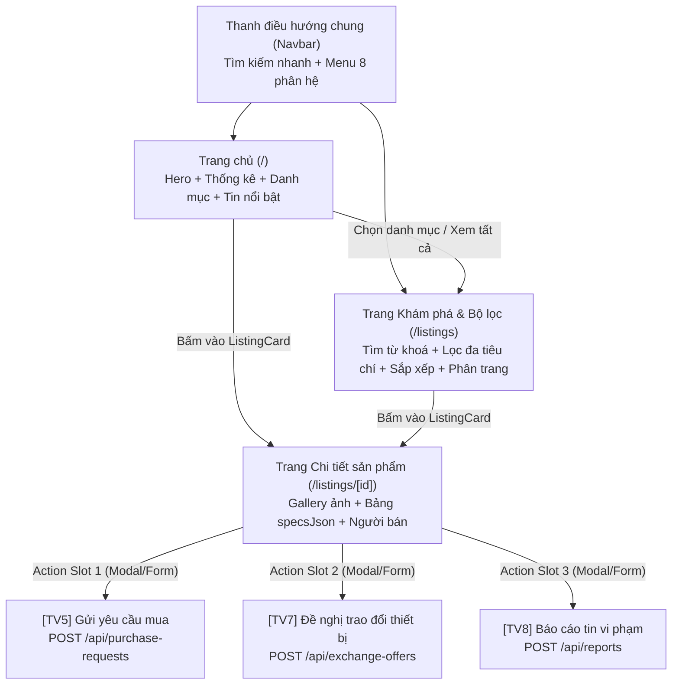

# SRS — Module Khám phá, Tìm kiếm & Lọc + UI/UX Design System (TV4)

**Phiên bản:** 1.0 · **Ngày:** Sprint 1 · **Người viết:** TV4 (UI/UX Lead & Discovery Owner)

---

## 1. MỤC TIÊU

Phân hệ của **Thành viên 4 (TV4)** đảm nhận 2 vai trò song song trong dự án **ElectroSwap C2C**:

1. **Mũ 1 — UI/UX Lead (Design System, Wireframe & Shared Layout):**
   - Thiết kế Wireframe 4 màn hình lõi và xây dựng khung giao diện dùng chung (`Navbar`, `Footer`, `Container`, hệ màu Indigo/Slate/Violet trong `src/app/globals.css`).
   - Xây dựng trọn bộ **13 UI Components dùng chung** (`src/components/ui/`) gồm: `Button`, `Input`, `Textarea`, `Select`, `Card`, `StatusBadge` (`Badge`), `PriceText`, `ListingCard`, `Pagination`, `EmptyState`, `ErrorState`, `PageLoader`, `Modal`, `ConfirmDialog`, `ModulePlaceholder`.
   - Khởi tạo sẵn các route khung (placeholder) và **3 Action Slots** trên trang chi tiết để 7 thành viên còn lại gắn tính năng mà không xung đột (Merge Conflict) vào `layout.tsx` hay `Navbar`.
2. **Mũ 2 — Chủ sở hữu Module Discovery (`src/features/discovery/`):**
   - Xây dựng hoàn chỉnh **Trang chủ (`/`)**, **Trang Khám phá & Lọc đa tiêu chí (`/listings`)**, và **Trang Chi tiết thiết bị (`/listings/[id]`)** truy vấn trực tiếp từ CSDL SQLite qua Prisma Server Components.

---

## 2. ACTOR LIÊN QUAN

| Actor | Tương tác với Module TV4 |
|---|---|
| **Khách vãng lai (Guest)** | Xem trang chủ, tìm kiếm theo từ khoá, lọc đa tiêu chí, xem chi tiết thiết bị & bảng thông số `specsJson`. |
| **Người mua / Người trao đổi (Registered User)** | Tìm kiếm thiết bị, lọc riêng các máy có bật **"Nhận trao đổi"** (`allowExchange = true`), bấm vào 3 vùng nút bấm (Action Slots) trên trang chi tiết để gửi Yêu cầu mua (TV5), Đề nghị trao đổi (TV7) hoặc Báo cáo vi phạm (TV8). |
| **Người bán (Seller)** | Xem tin đăng công khai của mình sau khi được Admin duyệt sang trạng thái `ACTIVE`. |
| **7 Thành viên phát triển (TV1, TV2, TV3, TV5, TV6, TV7, TV8)** | Tái sử dụng Shared Layout, bộ UI Kit (`@/components/ui`) và gắn logic nghiệp vụ vào 3 Action Slots trên `/listings/[id]`. |

---

## 3. USE CASE & WIREFRAME LUỒNG MÀN HÌNH

### 3.1 Sơ đồ luồng màn hình (Screen Flow — Mermaid)



### 3.2 Đặc tả Wireframe 4 màn hình cốt lõi (WBS 1.5 & 1.6)

#### Màn hình 1: Trang chủ (`/`) & Khám phá sản phẩm (`/listings`)
```
+-----------------------------------------------------------------------------------+
| [Logo ElectroSwap C2C]   [ Ô tìm kiếm nhanh từ khoá...       ]  [Đăng nhập] [+Đăng]|
| Khám phá | Đăng tin(TV3) | Tin của tôi(TV3) | Yêu cầu mua(TV5) | Giao dịch(TV6)...|
+-----------------------------------------------------------------------------------+
| [BỘ LỌC ĐA TIÊU CHÍ - DiscoveryFilterBar]                                         |
| Từ khoá: [________] Danh mục: [Tất cả v] Hãng: [Tất cả v] Tình trạng: [Tất cả v]  |
| Giá từ: [________] Giá đến: [________] Sắp xếp: [Mới nhất v] [x] Chỉ nhận trao đổi|
+-----------------------------------------------------------------------------------+
| Hiển thị 10 kết quả phù hợp                                                       |
| +-------------------------+ +-------------------------+ +-----------------------+ |
| | [Mới 99%]  [🔄 Trao đổi]| | [Mới 100%]              | | [Cũ - Tốt] [🔄 Đổi]   | |
| |      [Ảnh thiết bị]     | |      [Ảnh thiết bị]     | |     [Ảnh thiết bị]    | |
| | Điện thoại • Apple      | | Laptop • Dell           | | Máy tính bảng • Apple | |
| | iPhone 15 Pro Max 256GB | | Dell XPS 13 Plus 9320   | | iPad Air 5 M1 64GB    | |
| | 24.500.000 ₫            | | 28.000.000 ₫            | | 11.200.000 ₫          | |
| +-------------------------+ +-------------------------+ +-----------------------+ |
|                              [ « Trước ] [ 1 ] [ Sau » ]                          |
+-----------------------------------------------------------------------------------+
```

#### Màn hình 2: Chi tiết thiết bị & 3 Action Slots (`/listings/[id]`)
```
+-----------------------------------------------------------------------------------+
| Trang chủ / Khám phá / Điện thoại di động / iPhone 15 Pro Max 256GB Titan Tự Nhiên |
+-------------------------------------------------+---------------------------------+
| CỘT TRÁI (7/12): HÌNH ẢNH & THÔNG SỐ KỸ THUẬT  | CỘT PHẢI (5/12): GIÁ & SLOTS    |
| +---------------------------------------------+ | [📱 Điện thoại] [Hãng: Apple]   |
| | [Mới 99% (Like New)] [Đang bán] [🔄 Trade]  | | iPhone 15 Pro Max 256GB         |
| |              ẢNH CHÍNH (4:3)                | | Giá niêm yết: 24.500.000 ₫      |
| | [Thumb 1] [Thumb 2] [Thumb 3]               | | 🔄 Nhận đổi: Đổi iPad Pro M2... |
| +---------------------------------------------+ | 👤 Người bán: Nguyễn Văn An     |
| | ⚙️ BẢNG THÔNG SỐ KỸ THUẬT (specsJson)       | |---------------------------------|
| | Ram            | 8GB                        | | [SLOT TV5: 🛒 Gửi yêu cầu mua] |
| | Dung lượng     | 256GB                      | | [SLOT TV7: 🔄 Đề nghị trao đổi] |
| | Pin            | 98% (4422 mAh)             | |---------------------------------|
| +---------------------------------------------+ | [SLOT TV8: 🚩 Báo cáo vi phạm]  |
+-------------------------------------------------+---------------------------------+
```

#### Màn hình 3 & 4: Khung chuẩn cho Form Đăng nhập (`/login` — TV1) & Đăng tin (`/listings/create` — TV3)
- Sử dụng `Container`, `Card`, `Input`, `Select`, `Textarea`, `Button` trong `@/components/ui` để đảm bảo khoảng cách, bo góc (`rounded-2xl`), và hiển thị lỗi (`error` prop) đồng nhất 100%.

---

### 3.3 Đặc tả chi tiết các Use Case

#### UC-DISC-01 — Khám phá Trang chủ (`/`)
- **Actor:** Guest, Registered User, Admin
- **Tiền điều kiện:** CSDL đã được khởi tạo và nạp dữ liệu mẫu (`npx prisma db seed`).
- **Luồng chính:**
  1. Người dùng truy cập đường dẫn `/`.
  2. Hệ thống gọi `getHomeDiscoveryData()` truy vấn song song:
     - Danh sách danh mục kèm số lượng tin đang `ACTIVE`.
     - 8 tin đăng mới nhất có `status = "ACTIVE"`.
     - 4 tin đăng nổi bật có `status = "ACTIVE"` và `allowExchange = true`.
     - Thống kê nhanh tổng số tin `ACTIVE`, số tin nhận trao đổi, số danh mục và thương hiệu.
  3. Hệ thống hiển thị Hero Banner, lưới danh mục, khu vực thiết bị nhận trao đổi và danh sách tin mới đăng.
- **Luồng ngoại lệ:**
  - **E1 (Chưa có tin đăng ACTIVE nào):** Hiển thị `EmptyState` kèm nút dẫn tới `/listings/create`.
- **Hậu điều kiện:** Không làm thay đổi trạng thái CSDL.

#### UC-DISC-02 — Tìm kiếm và Lọc đa tiêu chí (`/listings`)
- **Actor:** Guest, Registered User, Admin
- **Tiền điều kiện:** Người dùng truy cập `/listings` hoặc gửi form tìm kiếm từ `Navbar` / `DiscoveryFilterBar`.
- **Luồng chính:**
  1. Hệ thống đọc `searchParams` từ URL và chuẩn hoá qua hàm `parseDiscoveryFilters()`:
     - `q`: Từ khoá (tìm kiếm trong `title`, `description`, `brand.name`, `category.name`).
     - `category`: Slug danh mục (`dien-thoai`, `laptop`, `may-tinh-bang`, `phu-kien`, `am-thanh`).
     - `brand`: Slug thương hiệu (`apple`, `samsung`, `sony`, `dell`, `asus`, `xiaomi`).
     - `condition`: Tình trạng vật lý (`NEW`, `LIKE_NEW`, `GOOD`, `FAIR`, `FOR_PARTS`).
     - `allowExchange`: Chỉ lọc thiết bị có `allowExchange = true` khi giá trị là `"true"` hoặc `"1"`.
     - `minPrice`, `maxPrice`: Khoảng giá bằng số nguyên dương (VNĐ).
     - `sort`: `newest` (mặc định), `price_asc` (giá tăng dần), `price_desc` (giá giảm dần).
     - `page`, `limit`: Phân trang chuẩn.
  2. Hệ thống gọi `searchPublicListings(filters)` luôn ép điều kiện bất biến `status = LISTING_STATUS.ACTIVE`.
  3. Hệ thống hiển thị các chip bộ lọc đang áp dụng, lưới `ListingCard` và thanh `Pagination`.
- **Luồng thay thế / ngoại lệ:**
  - **E1 (Người dùng nhập `minPrice > maxPrice`):** Hàm `parseDiscoveryFilters()` tự động hoán đổi `minPrice` và `maxPrice` để truy vấn không bị rỗng vô lý.
  - **E2 (Giá trị `condition` hoặc `sort` không hợp lệ trên URL):** Hệ thống tự động loại bỏ giá trị sai và quay về mặc định (`newest`).
  - **E3 (Không có sản phẩm khớp bộ lọc):** Hiển thị `EmptyState` với nút **"Xoá bộ lọc & Xem tất cả"** trỏ về `/listings`.
- **Hậu điều kiện:** URL phản ánh đúng bộ lọc hiện tại (có thể chia sẻ link).

#### UC-DISC-03 — Xem Chi tiết sản phẩm & Bảng thông số `specsJson` (`/listings/[id]`)
- **Actor:** Guest, Registered User, Admin
- **Tiền điều kiện:** Người dùng bấm vào 1 `ListingCard` hoặc truy cập trực tiếp `/listings/[id]`.
- **Luồng chính:**
  1. Hệ thống gọi `getListingDetailById(id)` truy vấn thông tin thiết bị, danh mục, thương hiệu, người bán (`select` tường minh, **không bao giờ lấy `passwordHash`**) và số lượng yêu cầu mua/trao đổi đang chờ.
  2. Kiểm tra điều kiện hiển thị công khai qua `isListingPubliclyVisible(status)` (hoặc trạng thái `IN_TRANSACTION` để người dùng xem thông tin nhưng khoá nút giao dịch mới).
  3. Giải mã an toàn chuỗi `imagesJson` (qua `parseImagesJson`) và `specsJson` (qua `parseSpecsJson`), chuyển khoá kỹ thuật sang nhãn tiếng Việt bằng `formatSpecLabel()`.
  4. Hiển thị bộ sưu tập ảnh `ListingImageGallery`, bảng thông số kỹ thuật, mô tả, thông tin người bán, **3 vùng nút bấm (`ListingActionSlots`)** và 4 sản phẩm liên quan cùng danh mục.
- **Luồng ngoại lệ:**
  - **E1 (ID không tồn tại hoặc tin đang ở trạng thái `PENDING`, `HIDDEN`, `REJECTED`):** Hàm `getListingDetailById` trả về `{ listing: null, relatedListings: [] }`, giao diện hiển thị `EmptyState` thông báo tin không tồn tại hoặc đã bị ẩn.
  - **E2 (`specsJson` hoặc `imagesJson` bị lỗi cú pháp JSON trong DB):** Helper `parseSpecsJson` / `parseImagesJson` bắt lỗi an toàn (`try/catch`), trả về `{}` hoặc ảnh mặc định `/images/placeholder-device.svg`, không làm sập trang.
  - **E3 (Tin đăng không bật `allowExchange`):** Nút Action Slot 2 ("Đề nghị trao đổi thiết bị" của TV7) tự động chuyển sang trạng thái `disabled` kèm giải thích rõ ràng.
- **Hậu điều kiện:** Hiển thị đầy đủ dữ liệu chi tiết và sẵn sàng kích hoạt 3 Action Slots cho TV5, TV7, TV8.

---

## 4. YÊU CẦU CHỨC NĂNG (FR)

| Mã | Yêu cầu chức năng | Ưu tiên |
|---|---|---|
| **FR-4.01** | Xây dựng `Navbar` và `Footer` dùng chung với thanh tìm kiếm nhanh và menu điều hướng đủ 8 phân hệ. | Bắt buộc |
| **FR-4.02** | Xây dựng đầy đủ bộ **UI Kit dùng chung** (`src/components/ui/`) gồm: `Button`, `Input`, `Textarea`, `Select`, `Card`, `StatusBadge`, `PriceText`, `ListingCard`, `Pagination`, `EmptyState`, `ErrorState`, `PageLoader`, `Modal`, `ConfirmDialog`. | Bắt buộc |
| **FR-4.03** | Trang chủ (`/`) hiển thị thống kê sàn, danh mục kèm số lượng tin, danh sách thiết bị nhận trao đổi và tin đăng mới nhất từ DB thật. | Bắt buộc |
| **FR-4.04** | Trang khám phá (`/listings`) hỗ trợ tìm kiếm theo từ khoá (`q`) và lọc đa tiêu chí (`category`, `brand`, `condition`, `minPrice`, `maxPrice`, `allowExchange`, `sort`, `page`). | Bắt buộc |
| **FR-4.05** | Chỉ hiển thị công khai các tin đăng có `status = "ACTIVE"` trên trang chủ và trang danh sách tìm kiếm. | Bắt buộc |
| **FR-4.06** | Trang chi tiết (`/listings/[id]`) hiển thị bộ sưu tập ảnh `ListingImageGallery`, bảng thông số kỹ thuật từ `specsJson`, mô tả, thông tin người bán và sản phẩm cùng danh mục. | Bắt buộc |
| **FR-4.07** | Thiết kế sẵn **3 Action Slots** (`data-slot="tv5-purchase-action"`, `data-slot="tv7-exchange-action"`, `data-slot="tv8-report-action"`) kèm Modal tích hợp cho TV5, TV7, TV8. | Bắt buộc |
| **FR-4.08** | Tạo sẵn các trang khung (placeholder routes) cho các phân hệ chưa code xong để không ai phải sửa `Navbar` hoặc `layout.tsx`. | Bắt buộc |

---

## 5. YÊU CẦU PHI CHỨC NĂNG (NFR)

| Mã | Yêu cầu phi chức năng |
|---|---|
| **NFR-4.01** | **Bảo mật dữ liệu:** Mọi truy vấn `seller` trong `src/features/discovery/queries.ts` bắt buộc dùng `select: { id, fullName, phone, avatarUrl, role, isActive }`, tuyệt đối không lộ `passwordHash`. |
| **NFR-4.02** | **An toàn kiểu (Type Safety):** TypeScript `strict: true`, không sử dụng `any`, `@ts-ignore` hoặc `dangerouslySetInnerHTML`. |
| **NFR-4.03** | **Khả năng chịu lỗi dữ liệu (Resilience):** Chuỗi JSON (`imagesJson`, `specsJson`) hoặc query string bất thường không bao giờ gây lỗi 500 trên giao diện. |
| **NFR-4.04** | **Responsive Design:** Giao diện tương thích mượt mà trên cả Mobile (1 cột), Tablet (2 cột) và Desktop (3–4 cột). |

---

## 6. RÀNG BUỘC DỮ LIỆU & HƯỚNG DẪN TÁI SỬ DỤNG UI KIT CHO 7 THÀNH VIÊN

### 6.1 Ràng buộc trạng thái hiển thị
- Danh sách công khai (`/` và `/listings`): luôn lọc `status: LISTING_STATUS.ACTIVE`.
- Trang chi tiết (`/listings/[id]`): chỉ cho phép hiển thị khi `isListingPubliclyVisible(status)` là `true` (hoặc đang `IN_TRANSACTION`). Các tin `PENDING`, `HIDDEN`, `REJECTED` bị chặn hoàn toàn khỏi chế độ xem công khai.
- Nút giao dịch (`isAvailableForDeal`): chỉ bật khi `listing.status === LISTING_STATUS.ACTIVE`.

### 6.2 Bảng tra cứu Component dùng chung (`@/components/ui`)

| Component | Import từ `@/components/ui` | Mục đích sử dụng cho các TV |
|---|---|---|
| `ListingCard` | `import { ListingCard } from "@/components/ui"` | Hiển thị thẻ sản phẩm đồng nhất (TV3, TV4, TV7). |
| `StatusBadge` / `Badge` | `import { StatusBadge } from "@/components/ui"` | Hiển thị nhãn màu trạng thái cho `listing`, `condition`, `purchase`, `exchange`, `transaction`, `report`, `user`. |
| `PriceText` | `import { PriceText, formatPriceVnd } from "@/components/ui"` | Định dạng tiền tệ VNĐ thống nhất (`24.500.000 ₫`). |
| `Button` | `import { Button } from "@/components/ui"` | Nút bấm chuẩn (`primary`, `secondary`, `outline`, `exchange`, `danger`, `ghost`). |
| `Input`, `Textarea`, `Select` | `import { Input, Textarea, Select } from "@/components/ui"` | Các trường nhập liệu chuẩn có sẵn `label`, `error`, `helperText` cho Form của TV1, TV3, TV5, TV7, TV8. |
| `Modal`, `ConfirmDialog` | `import { Modal, ConfirmDialog } from "@/components/ui"` | Hộp thoại nổi và hộp thoại xác nhận hành động (TV3 ẩn tin, TV5/TV7 gửi đề nghị, TV6 xác nhận/huỷ giao dịch, TV8 duyệt/báo cáo). |
| `EmptyState`, `ErrorState`, `PageLoader` | `import { EmptyState, ErrorState, PageLoader } from "@/components/ui"` | Trạng thái danh sách rỗng, thông báo lỗi và khung tải trang Skeleton. |

---

## 7. TIÊU CHÍ CHẤP NHẬN (ACCEPTANCE CRITERIA)

- [x] **AC-4.01:** Truy cập `/` hiển thị đúng các danh mục, tin đăng nổi bật và tin nhận trao đổi từ CSDL SQLite.
- [x] **AC-4.02:** Truy cập `/listings?category=dien-thoai&allowExchange=true` chỉ trả về các điện thoại đang ở trạng thái `ACTIVE` và có `allowExchange = true`.
- [x] **AC-4.03:** Nhập `minPrice=30000000&maxPrice=10000000` (min > max) hệ thống tự động đảo lại thành `10.000.000 ₫ – 30.000.000 ₫` và trả kết quả đúng.
- [x] **AC-4.04:** Các tin ở trạng thái `PENDING` (ví dụ `listing-10` trong seed) không xuất hiện trên `/listings` và không xem được trên `/listings/listing-10`.
- [x] **AC-4.05:** Trang `/listings/listing-01` hiển thị đầy đủ ảnh, bảng thông số `specsJson`, thông tin người bán (không lộ `passwordHash`), và đủ 3 vùng Action Slots cho TV5, TV7, TV8.
- [x] **AC-4.06:** Toàn bộ bộ kiểm thử `npm run check` (`tsc --noEmit && vitest run`) vượt qua 100%.

---

## 8. TRUY VẾT (TRACEABILITY MATRIX)

| Mã yêu cầu | File hiện thực (Implementation) | File kiểm thử (Test) |
|---|---|---|
| **FR-4.01** | `src/components/layout/Navbar.tsx`, `src/components/layout/Footer.tsx`, `src/app/layout.tsx` | Kiểm thử giao diện & điều hướng |
| **FR-4.02** | `src/components/ui/ListingCard.tsx`, `StatusBadge.tsx`, `PriceText.tsx`, `Button.tsx`, `Input.tsx`, `Textarea.tsx`, `Select.tsx`, `Modal.tsx`, `ConfirmDialog.tsx`, `EmptyState.tsx`, `ErrorState.tsx`, `PageLoader.tsx`, `Pagination.tsx` | `tests/discovery.test.ts` |
| **FR-4.03** | `src/app/page.tsx`, `src/features/discovery/queries.ts` (`getHomeDiscoveryData`) | `tests/discovery.test.ts` |
| **FR-4.04, FR-4.05** | `src/app/listings/page.tsx`, `src/features/discovery/components/DiscoveryFilterBar.tsx`, `src/features/discovery/queries.ts` (`searchPublicListings`), `src/features/discovery/utils.ts` (`parseDiscoveryFilters`) | `tests/discovery.test.ts` |
| **FR-4.06** | `src/app/listings/[id]/page.tsx`, `src/features/discovery/components/ListingImageGallery.tsx`, `src/features/discovery/queries.ts` (`getListingDetailById`) | `tests/discovery.test.ts` |
| **FR-4.07** | `src/features/discovery/components/ListingActionSlots.tsx` | `tests/discovery.test.ts` |
