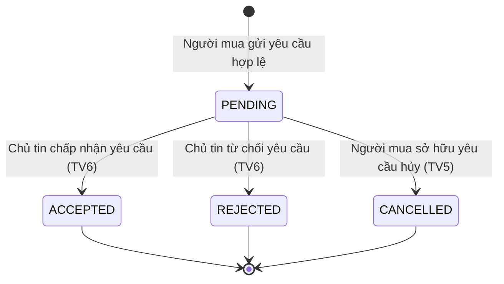
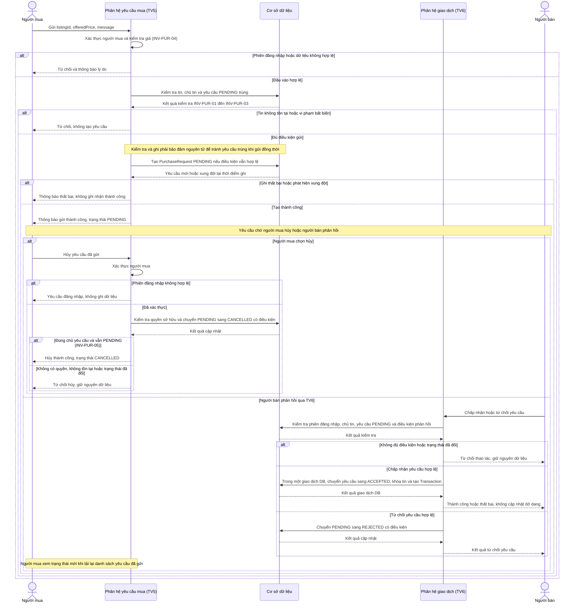

# SRS — Module Yêu cầu mua phía người mua (TV5)

**Dự án:** Electronics Trading & Exchange Marketplace — Nhóm 5, IT3180
**Người phụ trách:** TV5 — Workflow Analyst luồng Mua & Buyer Request
**Phiên bản:** 1.0 — Sprint 1

## 1. Mục tiêu và phạm vi

### 1.1. Mục tiêu

Đặc tả chức năng yêu cầu mua thiết bị điện tử phía người mua,
giúp người dùng gửi yêu cầu mua, theo dõi các yêu cầu đã gửi
và hủy yêu cầu khi chưa được người bán xử lý.

### 1.2. Phạm vi

Phân hệ bao gồm:

- Gửi yêu cầu mua trên một tin đăng.
- Xem danh sách yêu cầu mua đã gửi.
- Hủy yêu cầu mua đang chờ phản hồi.

Chức năng người bán chấp nhận hoặc từ chối yêu cầu, tạo giao dịch
và xác nhận hoàn tất thuộc phân hệ giao dịch của TV6.

Trong Sprint 1, TV5 bàn giao tài liệu đặc tả thuộc task 1.10, gồm State Machine
Diagram, Sequence Diagram và năm quy tắc bất biến của luồng yêu cầu mua.
Service, API, giao diện và test tự động không thuộc phạm vi bàn giao Sprint 1
theo thông báo của nhóm trưởng. Phần phản hồi của người bán trong sơ đồ là
điểm phối hợp với TV6, được mô tả để thể hiện đầy đủ luồng nghiệp vụ dự kiến.

## 2. Actor liên quan

| Actor | Vai trò |
|---|---|
| Người mua đã đăng nhập | Gửi, xem và hủy yêu cầu mua của mình |
| Người bán | Nhận và phản hồi yêu cầu mua thông qua phân hệ TV6 |

## 3. State Machine Diagram — Trạng thái yêu cầu mua

Sơ đồ mô tả vòng đời của một `PurchaseRequest`, không phải vòng đời của
`Listing` hay `Transaction`.

### 3.1. Ý nghĩa trạng thái

| Trạng thái | Ý nghĩa |
|---|---|
| `PENDING` | Yêu cầu đã được gửi, đang chờ người bán phản hồi |
| `ACCEPTED` | Người bán đã chấp nhận yêu cầu; tiếp tục xử lý giao dịch trong phân hệ TV6 |
| `REJECTED` | Người bán đã từ chối yêu cầu |
| `CANCELLED` | Người mua đã hủy yêu cầu trước khi người bán xử lý |

`ACCEPTED`, `REJECTED`, `CANCELLED` là trạng thái kết thúc của yêu cầu mua.
Không chuyển yêu cầu từ các trạng thái này về `PENDING` hoặc sang trạng thái
khác. `ACCEPTED` không có nghĩa là giao dịch đã hoàn tất.

### 3.2. Bảng chuyển trạng thái

| Trạng thái đầu | Sự kiện | Điều kiện | Trạng thái sau | Phụ trách |
|---|---|---|---|---|
| Chưa có yêu cầu | Gửi yêu cầu mua | Đạt INV-PUR-01 đến INV-PUR-04 và có phiên đăng nhập hợp lệ | `PENDING` | TV5 |
| `PENDING` | Hủy yêu cầu | Người thao tác là chủ yêu cầu và đạt INV-PUR-05 | `CANCELLED` | TV5 |
| `PENDING` | Chấp nhận yêu cầu | Người thao tác là chủ tin; tin vẫn `ACTIVE`; bảo đảm không phát sinh giao dịch trùng | `ACCEPTED` | TV6 |
| `PENDING` | Từ chối yêu cầu | Người thao tác là chủ tin | `REJECTED` | TV6 |

Gửi hoặc hủy yêu cầu mua không tự thay đổi trạng thái tin đăng và không tạo
giao dịch. Chỉ khi người bán chấp nhận, TV6 mới xử lý đồng thời việc chấp nhận
yêu cầu, khóa tin sang `IN_TRANSACTION` và tạo `Transaction`. Nếu TV6 chấp nhận
một yêu cầu khác trên cùng tin, yêu cầu đang chờ có thể chuyển sang `REJECTED`
theo quy tắc của phân hệ TV6.

## 4. Sequence Diagram — Gửi yêu cầu, hủy hoặc nhận phản hồi

Sơ đồ dưới đây là đặc tả nghiệp vụ của phân hệ. Phần kiểm tra
và cập nhật dữ liệu phải được thực hiện ở phía server; danh tính người thao tác
được lấy từ phiên đăng nhập, không tin `buyerId` do client tự cung cấp.

**Lưu ý xử lý đồng thời:** hủy và phản hồi đều phải kiểm tra lại trạng thái
ngay lúc ghi. Nếu hai bên thao tác đồng thời, chỉ một chuyển trạng thái từ
`PENDING` được thành công; thao tác còn lại bị từ chối. Không được ghi đè
`ACCEPTED` hoặc `REJECTED` thành `CANCELLED`, hay chấp nhận yêu cầu đã hủy.
Nếu người mua chưa xác thực, không được thực hiện thao tác ghi dữ liệu.

## 5. Đặc tả các quy tắc bất biến

### INV-PUR-01 — Chỉ tin ACTIVE nhận yêu cầu mua

- **Điều kiện:** `isListingAvailableForDeal(listing.status)` phải trả về `true`,
  tương ứng `listing.status === "ACTIVE"`.
- **Thời điểm kiểm tra:** khi xử lý gửi yêu cầu ở server, dựa trên trạng thái
  hiện tại trong DB; không chỉ dựa trên dữ liệu đã hiển thị ở trang chi tiết.
- **Khi vi phạm:** từ chối tạo yêu cầu nếu tin đang `PENDING`, `HIDDEN`,
  `REJECTED`, `IN_TRANSACTION`, `SOLD` hoặc `EXCHANGED`.
  Nếu tin không tồn tại, thông báo không tìm thấy tin.
- **Khi hợp lệ:** tạo yêu cầu `PENDING`; tin vẫn giữ trạng thái `ACTIVE`.
- **Ví dụ:** người mua đang xem tin `ACTIVE`, nhưng trước khi gửi tin đã được
  khóa sang `IN_TRANSACTION` thì hệ thống phải từ chối yêu cầu mới.

### INV-PUR-02 — Không mua tin của chính mình

- **Điều kiện:** `buyerId !== listing.sellerId`.
- **Nguồn dữ liệu:** `buyerId` lấy từ phiên đăng nhập hợp lệ;
  `listing.sellerId` lấy từ DB.
- **Khi vi phạm:** từ chối tạo yêu cầu và thông báo người dùng không được mua
  tin của chính mình, kể cả khi gửi yêu cầu trực tiếp ngoài giao diện.
- **Ví dụ:** người dùng A đăng tin X thì A không thể gửi yêu cầu mua X.

### INV-PUR-03 — Không có hai yêu cầu PENDING cho cùng người mua và tin

- **Điều kiện:** không tồn tại `PurchaseRequest` có đồng thời
  `buyerId` bằng người mua hiện tại, `listingId` bằng tin đang chọn và
  `status === "PENDING"`.
- **Phạm vi:** mỗi cặp `(buyerId, listingId)` có tối đa một yêu cầu `PENDING`.
  Những người mua khác nhau vẫn được gửi yêu cầu trên cùng một tin `ACTIVE`.
- **Khi vi phạm:** thông báo đã có yêu cầu đang chờ phản hồi; không tạo thêm
  bản ghi, kể cả khi bấm gửi nhiều lần hoặc gửi đồng thời từ nhiều cửa sổ.
- **Gửi lại:** yêu cầu cũ `REJECTED` hoặc `CANCELLED` không chặn một yêu cầu
  mới nếu tin vẫn `ACTIVE` và các quy tắc khác đều được đáp ứng.
  Bản ghi cũ giữ nguyên trạng thái kết thúc, không được mở lại.
- **Ví dụ:** A đã có yêu cầu `PENDING` trên tin X thì A không được gửi thêm
  yêu cầu trên X, nhưng B vẫn được gửi nếu đủ điều kiện.

### INV-PUR-04 — Giá đề xuất không âm

- **Điều kiện:** `offeredPrice` là số nguyên, đơn vị VND và
  `offeredPrice >= 0`, phù hợp kiểu `Int` trong schema.
- **Giá trị dương:** thể hiện mức giá người mua đề xuất cho người bán.
- **Giá trị bằng 0:** thể hiện đồng ý mua đúng giá niêm yết của tin đăng,
  không có nghĩa là nhận thiết bị miễn phí.
- **Khi vi phạm:** thiếu giá, giá âm, giá thập phân hoặc dữ liệu không phải
  số nguyên hợp lệ phải bị từ chối; không tự chuyển giá sai thành `0`.
- **Ví dụ:** `0` và `5000000` hợp lệ; `-1`, `1000.5` và `"abc"` không hợp lệ.

### INV-PUR-05 — Chỉ hủy yêu cầu đang PENDING

- **Điều kiện trạng thái:**
  `canTransitionPurchaseRequest(request.status, "CANCELLED")` phải trả về
  `true`; theo bảng chuyển trạng thái hiện tại, chỉ `PENDING` đáp ứng điều kiện.
- **Điều kiện quyền:** người thao tác phải đăng nhập và là chủ yêu cầu,
  tức `currentUser.id === request.buyerId`.
- **Khi hợp lệ:** chuyển duy nhất yêu cầu đó từ `PENDING` sang `CANCELLED`;
  không đổi trạng thái tin đăng và không xóa bản ghi yêu cầu.
- **Khi vi phạm:** từ chối hủy yêu cầu không tồn tại, yêu cầu của người khác
  hoặc yêu cầu đã `ACCEPTED`, `REJECTED`, `CANCELLED`.
- **Ví dụ:** nếu người bán đã chấp nhận trước khi người mua xác nhận hủy,
  yêu cầu vẫn giữ `ACCEPTED`; việc hủy giao dịch sau đó thuộc TV6.

Các helper trên đã có tại `src/lib/listing-state.ts`. Khi triển khai sau này,
giá trị trạng thái phải lấy từ `src/lib/constants.ts` thay vì định nghĩa lại.

## 6. Tiêu chí chấp nhận và kịch bản kiểm chứng

Các tình huống dưới đây là tiêu chí kiểm chứng cho giai đoạn triển khai sau.
Đây là kịch bản được đặc tả trong tài liệu, không phải báo cáo kết quả chạy
test hoặc yêu cầu bàn giao test tự động trong Sprint 1.

| Mã | Tình huống | Kết quả mong đợi | Quy tắc |
|---|---|---|---|
| TC-PUR-01 | Người mua đăng nhập, tin của người khác đang `ACTIVE`, giá là số nguyên dương và chưa có yêu cầu trùng | Tạo một yêu cầu `PENDING`; tin vẫn `ACTIVE`; chưa tạo `Transaction` | INV-PUR-01–04 |
| TC-PUR-02 | Gửi yêu cầu với `offeredPrice = 0` và các điều kiện khác hợp lệ | Gửi thành công; `0` được hiểu là đồng ý giá niêm yết | INV-PUR-04 |
| TC-PUR-03 | Gửi yêu cầu trên tin không tồn tại | Thông báo không tìm thấy; không tạo yêu cầu | INV-PUR-01 |
| TC-PUR-04 | Gửi yêu cầu trên từng trạng thái tin khác `ACTIVE`, hoặc trạng thái tin đổi trước khi ghi | Từ chối; không tạo yêu cầu | INV-PUR-01 |
| TC-PUR-05 | Gửi yêu cầu trên tin của chính mình | Từ chối; không tạo yêu cầu | INV-PUR-02 |
| TC-PUR-06 | Đã có yêu cầu `PENDING` trên cùng cặp người mua và tin đăng | Từ chối gửi trùng; vẫn chỉ có một yêu cầu `PENDING` | INV-PUR-03 |
| TC-PUR-07 | Gửi đồng thời hai yêu cầu hợp lệ cho cùng cặp người mua và tin đăng | Chỉ một yêu cầu được tạo; yêu cầu còn lại bị từ chối do trùng | INV-PUR-03 |
| TC-PUR-08 | Hai người mua khác nhau gửi yêu cầu trên cùng tin `ACTIVE` | Mỗi người có thể tạo một yêu cầu `PENDING` nếu đủ điều kiện | INV-PUR-03 |
| TC-PUR-09 | Yêu cầu cũ đã `REJECTED` hoặc `CANCELLED`, tin vẫn `ACTIVE` | Có thể tạo yêu cầu mới; bản ghi cũ giữ nguyên trạng thái | INV-PUR-01, 03 |
| TC-PUR-10 | Giá bị thiếu, âm, có phần thập phân hoặc không phải số nguyên hợp lệ | Thông báo lỗi dữ liệu; không tạo yêu cầu | INV-PUR-04 |
| TC-PUR-11 | Chủ yêu cầu hủy khi yêu cầu còn `PENDING` | Chuyển sang `CANCELLED`; tin không đổi; yêu cầu không bị xóa | INV-PUR-05 |
| TC-PUR-12 | Hủy từng yêu cầu đã `ACCEPTED`, `REJECTED` hoặc `CANCELLED` | Từ chối; giữ nguyên trạng thái | INV-PUR-05 |
| TC-PUR-13 | Hủy yêu cầu của người khác hoặc yêu cầu không tồn tại | Từ chối; không thay đổi dữ liệu | INV-PUR-05 |
| TC-PUR-14 | Người mua hủy cùng lúc người bán chấp nhận hoặc từ chối | Chỉ một chuyển trạng thái thành công; không ghi đè trạng thái kết thúc | INV-PUR-05, phối hợp TV6 |
| TC-PUR-15 | Chưa đăng nhập hoặc phiên không hợp lệ khi gửi/hủy yêu cầu | Từ chối thao tác; không ghi dữ liệu | Điều kiện xác thực |

## 7. Tham chiếu và truy vết

| Nội dung | Nguồn tham chiếu |
|---|---|
| Nhiệm vụ tài liệu Sprint 1 của TV5 | `MEMBER-GUIDEBOOK.md`, Phần III — Thành viên 5; task 1.10 trong `agileplan.tsv` |
| Trạng thái và điều kiện chuyển trạng thái | `AGENTS.md`, mục 6; `src/lib/constants.ts`; `src/lib/listing-state.ts` |
| Dữ liệu `PurchaseRequest`, `Listing`, `Transaction` | `prisma/schema.prisma`; `docs/diagrams/erd.md` |
| Phạm vi gửi và hủy yêu cầu mua | `src/features/purchase/README.md` |
| Phạm vi phản hồi của người bán và giao dịch | `src/features/transaction/README.md` |
| Vùng triển khai và kiểm thử dự kiến ở sprint sau | `src/features/purchase/**`; `src/app/api/purchase-requests/**`; `src/app/buyer/requests/**`; `tests/purchase.test.ts` — không thuộc đầu ra Sprint 1 |

## 8. Phạm vi bàn giao Sprint 1

| Đầu ra | Vị trí trong tài liệu |
|---|---|
| State Machine Diagram bằng Mermaid `stateDiagram-v2` | Mục 3, kèm ý nghĩa trạng thái và bảng chuyển trạng thái |
| Sequence Diagram bằng Mermaid `sequenceDiagram` | Mục 4, gồm gửi yêu cầu, hủy hoặc người bán phản hồi và các nhánh lỗi |
| Đặc tả chi tiết năm quy tắc bất biến | Mục 5, từ INV-PUR-01 đến INV-PUR-05 |
| Tiêu chí kiểm chứng bổ trợ | Mục 6, gồm 15 kịch bản nghiệp vụ |

File bàn giao: `docs/srs/module-tv5-purchase.md`. Tài liệu được commit trên
nhánh riêng `feat/tv5-purchase` để nhóm review. Theo thông báo mới của nhóm
trưởng, Pull Request tài liệu gửi vào `main`; chỉ đưa file tài liệu này vào
PR Sprint 1. Code, API, giao diện và test tự động dành cho giai đoạn sau.
