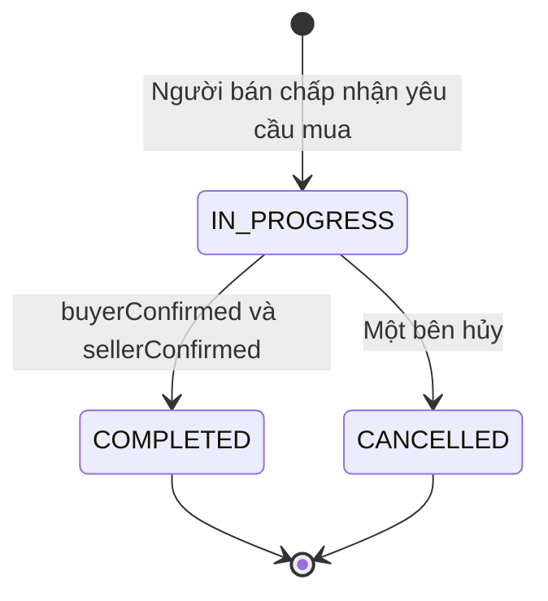
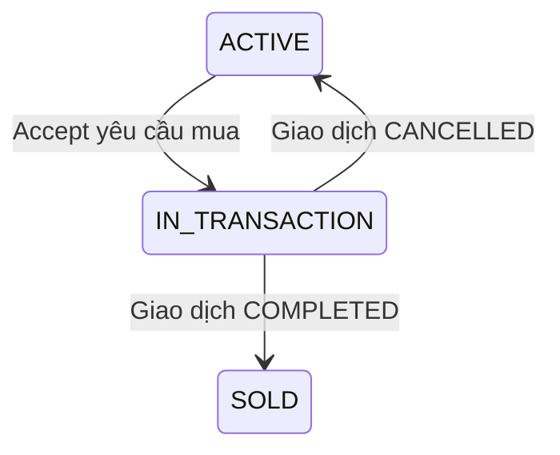
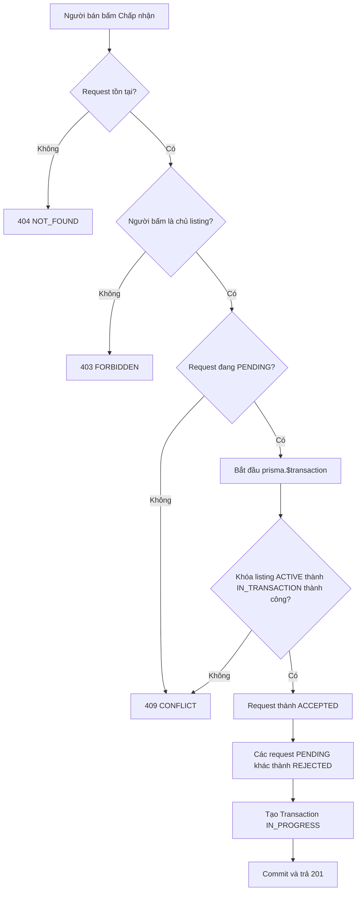
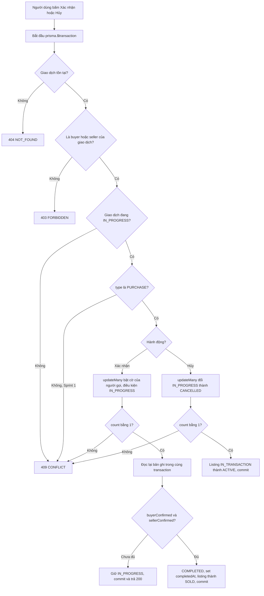
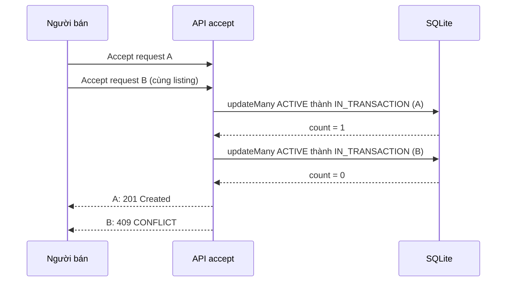

# Module TV6 — Xử lý đơn mua & Lịch sử giao dịch

> **Tác giả:** TV6 (Huy Tâm) · **Sprint:** 1 · **Nhóm 5 — IT3180**

## 1. Mục tiêu và phạm vi
Người bán chấp nhận hoặc từ chối yêu cầu mua. Chấp nhận thì hệ thống khóa tin đăng
và sinh một `Transaction`. Hai bên xác nhận để hoàn tất, hoặc một bên hủy để mở khóa.
Thanh toán, vận chuyển, gặp mặt nằm **ngoài hệ thống** (Out of Scope).

## 2. Tác nhân
| Tác nhân | Vai trò |
|---|---|
| Người bán | Chấp nhận / từ chối yêu cầu, xác nhận đã giao, hủy giao dịch |
| Người mua | Xác nhận đã nhận hàng, hủy giao dịch |
| Hệ thống | Khóa listing, tự từ chối yêu cầu còn lại, đổi trạng thái |

## 3. Use Case
| Mã | Tên | Điều kiện trước | Kết quả |
|---|---|---|---|
| UC-TXN-01 | Chấp nhận yêu cầu mua | Người gọi là chủ listing; request `PENDING`; listing `ACTIVE` | Request `ACCEPTED`, listing `IN_TRANSACTION`, sinh Transaction `IN_PROGRESS` |
| UC-TXN-02 | Từ chối yêu cầu mua | Người gọi là chủ listing; request `PENDING` | Request `REJECTED`, listing giữ nguyên |
| UC-TXN-03 | Xem lịch sử giao dịch | Đã đăng nhập | Danh sách giao dịch mà mình là buyer hoặc seller |
| UC-TXN-04 | Xác nhận giao dịch | Là buyer hoặc seller; Transaction `IN_PROGRESS` | Bật cờ của mình; đủ 2 cờ thì `COMPLETED` |
| UC-TXN-05 | Hủy giao dịch | Là buyer hoặc seller; Transaction `IN_PROGRESS` | `CANCELLED`, listing về `ACTIVE` |

## 4. Quy tắc nghiệp vụ
1. Chỉ chủ listing mới được accept/reject (`403 FORBIDDEN` nếu sai người).
2. Chỉ request `PENDING` mới được accept/reject (`409 CONFLICT` nếu khác).
3. Chỉ listing `ACTIVE` mới được khóa. Một listing chỉ nằm trong tối đa 1 giao dịch `IN_TRANSACTION`.
4. Khi accept, mọi request `PENDING` khác trên cùng listing tự động `REJECTED`.
5. Mỗi `PurchaseRequest` sinh tối đa 1 `Transaction` (`UNIQUE(purchaseRequestId)`).
6. Chỉ `COMPLETED` khi `buyerConfirmed && sellerConfirmed`.
7. `COMPLETED` → listing `SOLD` (giao dịch mua; giao dịch trao đổi sẽ là `EXCHANGED`, TV6 mở rộng ở Sprint 3), set `completedAt`. `CANCELLED` → listing về `ACTIVE`.
8. `COMPLETED` và `CANCELLED` là trạng thái cuối.
9. Chỉ người thuộc giao dịch (buyer hoặc seller) mới được confirm/cancel.
10. Xác nhận lặp: nếu giao dịch còn `IN_PROGRESS` và cờ của người gọi đã `true`, API trả `200 OK` kèm trạng thái hiện tại và không đổi dữ liệu (idempotent). Nếu giao dịch đã `COMPLETED` hoặc `CANCELLED`, trả `409 CONFLICT`.
11. Confirm/cancel phân nhánh theo `type`: `PURCHASE` → `SOLD`; `EXCHANGE` → `EXCHANGED` cho cả hai listing. Trước Sprint 3, API từ chối giao dịch `EXCHANGE` (`409 CONFLICT`) để không bao giờ áp dụng luồng `SOLD` cho giao dịch trao đổi.
12. Hủy giao dịch không mở lại các request đã bị `REJECTED` khi accept; người mua gửi yêu cầu mới.
13. Accept trên listing không còn `ACTIVE` (ví dụ đã bị ẩn) trả `409 CONFLICT` với thông báo rõ "Tin đăng không còn ở trạng thái ACTIVE"; request giữ `PENDING` và người bán có thể từ chối thủ công.
14. Tài khoản `LOCKED` bị chặn ở tầng xác thực (TV1). Giao dịch không bị kẹt vì bên còn lại luôn có thể Hủy. Admin hủy cưỡng bức nằm ngoài phạm vi hiện tại.

## 5. Sơ đồ
### 5.1 State Machine — Transaction

### 5.2 State Machine — Listing (phần liên quan TV6)

### 5.3 Activity Diagram — Chấp nhận yêu cầu mua

### 5.4 Activity Diagram — Xác nhận và hủy giao dịch

## 6. Cơ chế xử lý đồng thời

### 6.1 Cơ chế chống Double-Booking
**Vấn đề:** hai request A và B cùng nhắm một listing, hai lần bấm accept gần như đồng thời.
**Giải pháp:** trong `prisma.$transaction`, khóa listing bằng một lệnh có điều kiện:
`updateMany({ where: { id, status: ACTIVE }, data: { status: IN_TRANSACTION } })`
rồi kiểm tra `count === 1`. Lệnh nào chạy trước thắng, lệnh sau có `count = 0` và trả `409`.
Lớp bảo vệ thứ hai: `UNIQUE(purchaseRequestId)` trên bảng Transaction.

### 6.2 Cơ chế an toàn cho Xác nhận và Hủy giao dịch
Hai luồng này cũng chạy trong `prisma.$transaction`:
- **Hủy:** `updateMany({ where: { id, status: IN_PROGRESS }, data: { status: CANCELLED } })`,
  kiểm tra `count === 1` rồi mới trả listing về `ACTIVE`.
- **Xác nhận:** chỉ cập nhật cờ của người gọi (`updateMany` có điều kiện `IN_PROGRESS`),
  sau đó đọc lại bản ghi trong cùng transaction; chỉ khi cả hai cờ là `true` mới chuyển
  `COMPLETED` và listing sang `SOLD`.
- **Kết quả:** nếu Xác nhận và Hủy xảy ra cùng lúc, bên đến sau nhận `409 CONFLICT`;
  nếu hai bên cùng Xác nhận, không cờ nào bị ghi đè.
- **Thứ tự thao tác:** trong transaction, thao tác ghi (`updateMany`) được đặt trước thao tác đọc lại,
  không đọc rồi mới ghi dựa trên dữ liệu cũ.

## 7. Danh sách API
| Method | Endpoint | Mô tả | Lỗi thường gặp |
|---|---|---|---|
| POST | `/api/purchase-requests/[id]/accept` | Chấp nhận | 401, 403, 404, 409 |
| POST | `/api/purchase-requests/[id]/reject` | Từ chối | 401, 403, 404, 409 |
| GET | `/api/transactions` | Danh sách giao dịch | 401 |
| PATCH | `/api/transactions/[id]/confirm` | Xác nhận | 401, 403, 404, 409 |
| PATCH | `/api/transactions/[id]/cancel` | Hủy | 401, 403, 404, 409 |

## 8. Phụ thuộc module khác
- TV5 tạo `PurchaseRequest` (có `offeredPrice`, `0` nghĩa là giá niêm yết). Khi tạo yêu cầu mua, TV5 phải kiểm tra listing còn `ACTIVE` một cách an toàn (trong transaction) để không sinh request `PENDING` mồ côi trên tin đã `IN_TRANSACTION`.
- TV7 tạo Transaction `EXCHANGE`; TV6 mở rộng confirm/cancel ở Sprint 3.
- TV3: listing `IN_TRANSACTION` không được sửa (`isListingEditable`).
- TV1: cung cấp người dùng đang đăng nhập (từ phiên) để xác định người bán / người mua.