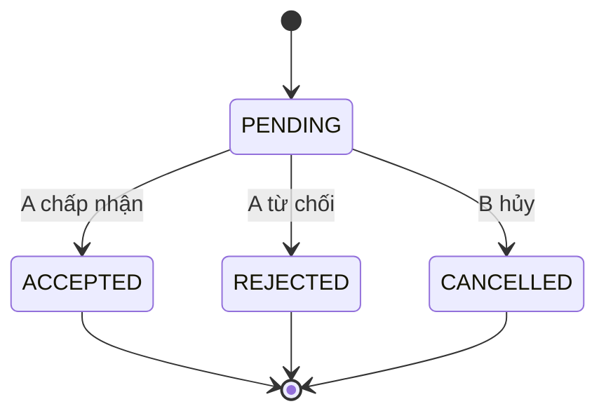
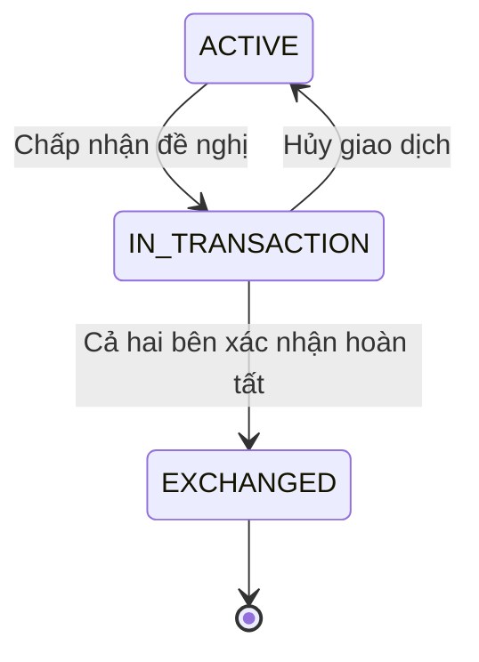
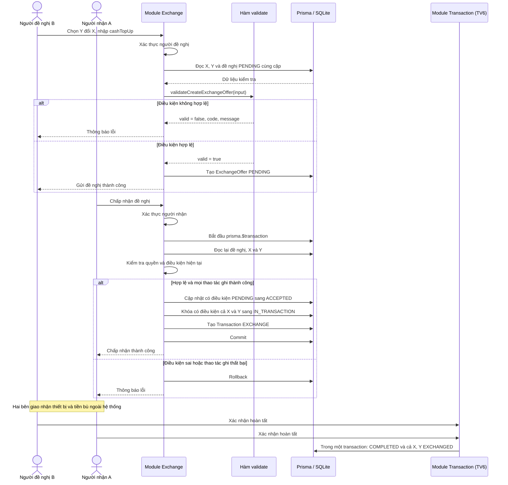

# SRS — Module Đề nghị Trao đổi thiết bị (TV7)

**Phiên bản:** 1.0  
**Sprint:** 1  
**Phụ trách:** TV7 — BA/Designer luồng Trao đổi

## 1. Mục tiêu

Đặc tả luồng người dùng B đem thiết bị Y của mình đề nghị đổi lấy
thiết bị X của người dùng A, có thể kèm tiền bù cashTopUp.

Đầu ra Sprint 1:
- Đặc tả nghiệp vụ và sơ đồ luồng trao đổi.
- Khung validate điều kiện gửi đề nghị.
- Unit test cho các quy tắc validate.

Không triển khai API, giao diện hoặc thao tác ghi dữ liệu trong phạm vi này.

## 2. Actor liên quan

| Actor | Vai trò |
|---|---|
| Người đề nghị B | Sở hữu Y, gửi hoặc hủy đề nghị |
| Người nhận A | Sở hữu X, chấp nhận hoặc từ chối đề nghị |
| Module Transaction — TV6 | Xử lý xác nhận hoàn tất hoặc hủy giao dịch |

## 3. Use Case

### UC-EXC-01 — Gửi đề nghị trao đổi

- **Actor:** Người đề nghị B.
- **Tiền điều kiện:**
  - B đã đăng nhập.
  - Thiết bị X và Y tồn tại.
- **Luồng chính:**
  1. B xem thiết bị X của A.
  2. B chọn thiết bị Y thuộc sở hữu của mình.
  3. B nhập tiền bù cashTopUp; bằng 0 nếu đổi ngang.
  4. Hệ thống kiểm tra các điều kiện trao đổi.
  5. Nếu hợp lệ, hệ thống cho phép tạo ExchangeOffer PENDING.
- **Luồng thay thế / ngoại lệ:**
  - Chưa đăng nhập: UNAUTHENTICATED.
  - Không tìm thấy X hoặc Y: NOT_FOUND.
  - X và Y trùng nhau: VALIDATION_ERROR.
  - X thuộc B: FORBIDDEN.
  - Y không thuộc B: FORBIDDEN.
  - Một trong hai tin không ACTIVE: CONFLICT.
  - X không bật allowExchange: CONFLICT.
  - Đã có đề nghị PENDING cùng cặp X, Y: CONFLICT.
  - Tiền bù không hợp lệ: VALIDATION_ERROR.
- **Hậu điều kiện:**
  - Đề nghị hợp lệ được tạo với trạng thái PENDING khi có API.
  - Việc gửi đề nghị không khóa hoặc thay đổi trạng thái hai tin.

### UC-EXC-02 — Chấp nhận đề nghị trao đổi

- **Actor:** Người nhận A.
- **Tiền điều kiện:**
  - A đã đăng nhập và là người nhận đề nghị.
  - Đề nghị còn PENDING.
  - X và Y vẫn đáp ứng điều kiện trao đổi.
- **Luồng chính:**
  1. A chọn chấp nhận đề nghị.
  2. Hệ thống đọc lại đề nghị và hai tin trong prisma.$transaction.
  3. Kiểm tra quyền, trạng thái đề nghị và điều kiện hiện tại của hai tin.
  4. Chuyển đề nghị từ PENDING sang ACCEPTED.
  5. Chuyển đồng thời X và Y từ ACTIVE sang IN_TRANSACTION.
  6. Tạo một Transaction có type = EXCHANGE.
  7. Commit toàn bộ thay đổi.
- **Luồng thay thế / ngoại lệ:**
  - Sai người nhận: FORBIDDEN.
  - Đề nghị không còn PENDING: CONFLICT.
  - Một trong hai tin không còn khả dụng: CONFLICT.
  - Bất kỳ thao tác ghi nào thất bại: rollback toàn bộ.
- **Hậu điều kiện:**
  - Có đúng một Transaction gắn với đề nghị.
  - Cả X và Y đều IN_TRANSACTION.

### UC-EXC-03 — Từ chối đề nghị

- **Actor:** Người nhận A.
- **Tiền điều kiện:** Đúng người nhận; đề nghị còn PENDING.
- **Luồng chính:** Chuyển đề nghị từ PENDING sang REJECTED.
- **Luồng thay thế / ngoại lệ:**
  - Sai người nhận: FORBIDDEN.
  - Đề nghị đã được xử lý: CONFLICT.
- **Hậu điều kiện:**
  - Không tạo Transaction.
  - Không cập nhật trạng thái hai tin.

### UC-EXC-04 — Hủy đề nghị

- **Actor:** Người đề nghị B.
- **Tiền điều kiện:** Đúng người gửi; đề nghị còn PENDING.
- **Luồng chính:** Chuyển đề nghị từ PENDING sang CANCELLED.
- **Luồng thay thế / ngoại lệ:**
  - Sai người gửi: FORBIDDEN.
  - Đề nghị đã được xử lý: CONFLICT.
- **Hậu điều kiện:**
  - Không tạo Transaction.
  - Không cập nhật trạng thái hai tin.

## 4. Yêu cầu chức năng

| Mã | Yêu cầu |
|---|---|
| FR-7.01 | Chặn dùng cùng một tin cho cả X và Y |
| FR-7.02 | Chặn đề nghị trao đổi tin của chính mình |
| FR-7.03 | Kiểm tra Y thuộc sở hữu người đề nghị |
| FR-7.04 | Kiểm tra cả X và Y đều ACTIVE |
| FR-7.05 | Kiểm tra X bật allowExchange |
| FR-7.06 | Chặn đề nghị PENDING trùng cặp X, Y |
| FR-7.07 | Kiểm tra tiền bù là số nguyên VND không âm |

## 5. Yêu cầu phi chức năng

- TypeScript strict; không dùng any.
- Không thêm dependency.
- Hàm validate không truy cập DB hoặc thay đổi dữ liệu đầu vào.
- Dùng constants và helper có sẵn trong src/lib.
- Biến và hàm đặt tên tiếng Anh theo camelCase.
- Kiểu dữ liệu đặt tên theo PascalCase.
- Comment và thông báo nghiệp vụ viết bằng tiếng Việt.
- Unit test không phụ thuộc dữ liệu SQLite.

## 6. Ràng buộc dữ liệu & trạng thái

### 6.1 Dữ liệu đầu vào của hàm validate

| Trường | Ý nghĩa |
|---|---|
| proposerId | ID người đề nghị, lấy từ phiên đăng nhập |
| targetListing | Thiết bị X, lấy từ dữ liệu backend |
| offeredListing | Thiết bị Y, lấy từ dữ liệu backend |
| cashTopUp | Tiền bù, đơn vị VND |
| hasPendingOffer | Có đề nghị PENDING cùng cặp X, Y hay không |

Hàm validate nhận dữ liệu đã được backend kiểm tra kiểu và đọc từ DB.
Xác thực phiên đăng nhập, kiểm tra tin tồn tại và truy vấn đề nghị trùng
thuộc trách nhiệm của lớp gọi hàm.

Không lấy proposerId hoặc thông tin sở hữu trực tiếp từ dữ liệu client
để quyết định quyền.

### 6.2 Quy tắc nghiệp vụ

1. targetListing.id khác offeredListing.id.
2. targetListing.sellerId khác proposerId.
3. offeredListing.sellerId bằng proposerId.
4. Cả hai tin phải ACTIVE.
5. Chỉ X bắt buộc bật allowExchange.
6. Không tồn tại đề nghị PENDING cho cùng cặp có hướng
   (targetListingId, offeredListingId).
7. cashTopUp là số nguyên từ 0 đến 2.147.483.647,
   phù hợp kiểu Prisma Int.

Quy ước của đặc tả: cashTopUp là khoản B bù thêm cho A.
Giá trị 0 biểu thị trao đổi ngang. Hệ thống chỉ ghi nhận số tiền,
không xử lý thanh toán.

### 6.3 Trạng thái đề nghị

ACCEPTED, REJECTED và CANCELLED là các trạng thái cuối của đề nghị.

### 6.4 Trạng thái hai thiết bị

Sơ đồ áp dụng cho cả X và Y:

Khi triển khai:
- TV7 xử lý chấp nhận đề nghị và khóa hai tin.
- TV6 xử lý hoàn tất hoặc hủy Transaction.
- ExchangeOffer vẫn ACCEPTED khi Transaction hoàn tất hoặc bị hủy.

### 6.5 Bất biến khi ghi dữ liệu

- Mỗi ExchangeOffer sinh tối đa một Transaction.
- Mỗi thiết bị tham gia tối đa một giao dịch đang thực hiện.
- Chuyển trạng thái đề nghị, khóa hai tin và tạo Transaction
  phải nằm trong một prisma.$transaction.
- Thao tác cập nhật phải có điều kiện trạng thái hiện tại;
  kiểm tra số bản ghi cập nhật, rollback nếu không đúng.
- Từ chối hoặc hủy đề nghị không tự đưa tin về ACTIVE:
  tin có thể đã tham gia giao dịch khác.
- Hàm validate Sprint 1 không tự bảo đảm chống double-booking.

## 7. Sequence Diagram

Đây là đặc tả luồng nghiệp vụ; Sprint 1 chưa hiện thực thao tác ghi DB.

## 8. Tiêu chí chấp nhận Sprint 1

- [ ] Đề nghị hợp lệ với tiền bù 0 hoặc số nguyên dương được chấp nhận.
- [ ] Chặn hai tin trùng ID.
- [ ] Chặn tự trao đổi tin của mình.
- [ ] Chặn dùng thiết bị không thuộc người đề nghị.
- [ ] Chặn mọi trạng thái khác ACTIVE ở X hoặc Y.
- [ ] Chặn X không bật nhận trao đổi.
- [ ] Không bắt buộc Y bật nhận trao đổi.
- [ ] Chặn đề nghị PENDING trùng cặp.
- [ ] Chặn tiền âm, số lẻ, NaN, Infinity và vượt miền Prisma Int.
- [ ] Không thay đổi dữ liệu đầu vào.
- [ ] npm run check thành công.

## 9. Truy vết

| Yêu cầu | File hiện thực | Test |
|---|---|---|
| FR-7.01 | src/features/exchange/validation.ts | Hai tin trùng ID |
| FR-7.02 | src/features/exchange/validation.ts | Tự trao đổi |
| FR-7.03 | src/features/exchange/validation.ts | Sai chủ sở hữu Y |
| FR-7.04 | src/features/exchange/validation.ts | Trạng thái X/Y |
| FR-7.05 | src/features/exchange/validation.ts | allowExchange |
| FR-7.06 | src/features/exchange/validation.ts | Đề nghị trùng |
| FR-7.07 | src/features/exchange/validation.ts | Tiền bù hợp lệ và không hợp lệ |

Các test nằm trong tests/exchange.test.ts.
Unit test Sprint 1 không kiểm chứng thao tác khóa hai tin trong DB.