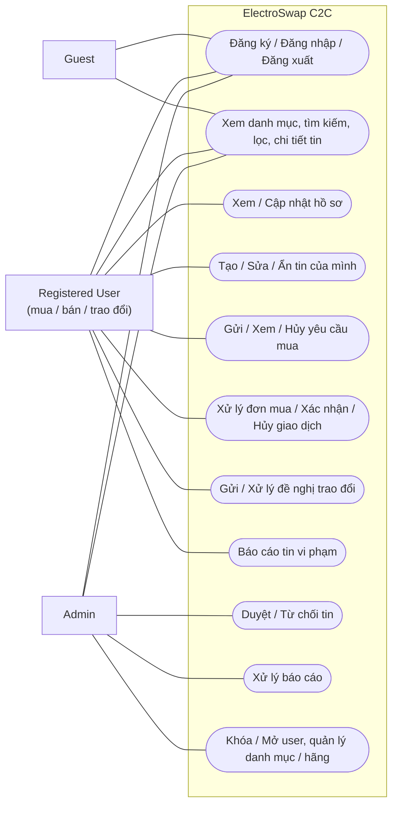

# SRS — Tổng quan hệ thống ElectroSwap C2C

**Học phần:** IT3180 · **Nhóm:** 5 · **Phiên bản:** 1.0 · **Sprint:** 1.
**Soạn thảo:** TV1 (PM), theo MEMBER-GUIDEBOOK.md; **review nội dung:** TV3 (BA Lead).

## 1. Mục tiêu và nguồn tham chiếu

ElectroSwap C2C hỗ trợ cá nhân đăng bán, tìm mua và đề nghị trao đổi thiết bị điện tử.
Một tài khoản có thể đồng thời là người mua, người bán và người đề nghị trao đổi.
Website ghi nhận yêu cầu và trạng thái giao dịch; hai bên tự thỏa thuận thanh toán,
giao nhận hoặc gặp mặt bên ngoài hệ thống.

Nguồn nghiệp vụ: [PROJECTPROPOSAL.md](../../PROJECTPROPOSAL.md).
Phân công: [MEMBER-GUIDEBOOK.md](../../MEMBER-GUIDEBOOK.md).
Quy ước hiện thực: [AGENTS.md](../../AGENTS.md).
Dữ liệu: [schema.prisma](../../prisma/schema.prisma) và [ERD](../diagrams/erd.md).
Kế hoạch sprint: [agileplan.tsv](../../agileplan.tsv).

Tài liệu này mô tả phạm vi yêu cầu của sản phẩm, không xác nhận mọi module đã được triển khai.
AGENTS.md và schema hiện tại dùng Next.js/SQLite. Các hướng dẫn NestJS/Vite/PostgreSQL
còn trong workbook/task card cũ không phải kiến trúc của bản mã này.

## 2. Actor

| Actor | Vai trò và giới hạn |
|---|---|
| Guest | Xem tin công khai, tìm kiếm/lọc, đăng ký và đăng nhập |
| Registered User | Guest + hồ sơ, đăng tin, yêu cầu mua, trao đổi, giao dịch và báo cáo vi phạm |
| Admin | Tài khoản ADMIN quản trị user, danh mục/hãng, duyệt tin và xử lý báo cáo |

Người mua/người bán/người trao đổi là vai trò nghiệp vụ của Registered User, không phải
ba loại tài khoản riêng. User LOCKED không được sử dụng phiên đăng nhập, kể cả phiên đã cấp.
Quyền và ownership phải được kiểm tra phía server; ẩn nút UI không thay thế phân quyền.

## 3. Phạm vi sản phẩm

| Trong phạm vi | Owner | Kết quả mong đợi |
|---|---|---|
| Tài khoản và hồ sơ | TV1 | Đăng ký/đăng nhập/đăng xuất, phiên cookie, thông tin cá nhân, phân quyền |
| Nền tảng và danh mục | TV2 | Schema/seed, danh mục và thương hiệu dùng chung |
| Tin đăng của người bán | TV3 | Tạo/sửa/ẩn tin, thông số, hình ảnh, tùy chọn nhận trao đổi |
| Khám phá | TV4 | Trang chủ, tìm kiếm/lọc, phân trang, chi tiết tin |
| Yêu cầu mua | TV5 | Gửi/xem/hủy yêu cầu mua của bản thân |
| Giao dịch | TV6 | Xử lý đơn mua, khóa thiết bị, xác nhận hai bên, lịch sử |
| Đề nghị trao đổi | TV7 | Chọn thiết bị đem đổi, gửi/xử lý đề nghị, khóa đồng thời hai tin |
| Admin và báo cáo | TV8 | Duyệt tin, khóa user, xử lý báo cáo, kế hoạch kiểm thử |

Ngoài phạm vi: thanh toán online, tích hợp vận chuyển, ký quỹ/giải quyết tranh chấp tài chính,
chat, đánh giá/rating, đấu giá, AI gợi ý/chatbot, định giá tự động.
Dự án chạy local; không triển khai hosting hoặc CI/CD trong phạm vi đồ án này.

## 4. Danh mục Use Case và sơ đồ tổng thể

| Mã | Use Case | Actor | Owner |
|---|---|---|---|
| UC-AUTH-01–03 | Đăng ký, đăng nhập, đăng xuất | Guest/User | TV1 |
| UC-AUTH-04 | Xem/cập nhật hồ sơ | User | TV1 |
| UC-CAT-01–02 | Xem danh mục, thương hiệu | Guest/User | TV2 |
| UC-LST-01–04 | Tạo, xem danh sách, sửa, ẩn/bỏ ẩn tin của mình | User (người bán) | TV3 |
| UC-DISC-01–03 | Tìm kiếm, lọc, xem chi tiết | Guest/User | TV4 |
| UC-PUR-01 | Gửi/xem/hủy yêu cầu mua | User (người mua) | TV5 |
| UC-TRX-01 | Xử lý yêu cầu mua, xác nhận/hủy giao dịch | User (hai bên) | TV6 |
| UC-EXC-01 | Gửi/xử lý/hủy đề nghị trao đổi | User (hai bên) | TV7 |
| UC-REP-01 | Báo cáo tin vi phạm | User | TV8 |
| UC-ADM-01–03 | Duyệt tin, xử lý báo cáo, quản trị user | Admin | TV8 |

Mã tổng quan của module chưa có SRS là mã dự kiến; owner chốt mã chi tiết khi viết SRS.
Mermaid dùng flowchart để biểu diễn quan hệ actor–use case:

## 5. Quy tắc nghiệp vụ cốt lõi

1. Chỉ tin ACTIVE nhận yêu cầu mua/trao đổi mới. Tin tạo mới PENDING, cần Admin duyệt.
2. Không tự mua hoặc đề nghị trao đổi tin của chính mình; không gửi trùng yêu cầu PENDING.
3. Một thiết bị chỉ tham gia tối đa một giao dịch đang hiệu lực; khóa tin trong cùng
   Prisma transaction khi nhận mua/trao đổi. Trao đổi khóa cả hai thiết bị đồng thời.
4. Giao dịch chỉ COMPLETED khi cả hai bên đã xác nhận. Mua hoàn tất chuyển tin SOLD;
   trao đổi hoàn tất chuyển cả hai tin EXCHANGED. Hủy mở lại tin về ACTIVE theo state machine.
5. SOLD/EXCHANGED là trạng thái cuối; không cho sửa tin đang IN_TRANSACTION hoặc đã kết thúc.
6. Sửa nội dung tin ACTIVE phải quay về PENDING để duyệt lại.
   Helper state machine hiện thiếu cạnh ACTIVE → PENDING: service sửa tin TV3 thực hiện
   quy tắc duyệt lại sau guard isListingEditable; TV2 phụ trách thống nhất helper chung.
7. Chỉ chủ thể hợp lệ được sửa dữ liệu của mình; chỉ ADMIN thực hiện nghiệp vụ quản trị.
8. Tiền là số nguyên VND. User không được tự gán role/status thông qua đăng ký.

Quy tắc chi tiết và trạng thái lấy từ AGENTS.md và src/lib/constants.ts.
Các bất nhất giữa đặc tả và helper được ghi thành việc phối hợp, không sửa file owner khác.

## 6. Phạm vi TV1 Sprint 1 và tiêu chí chấp nhận

| Đầu ra TV1 | Kiểm chứng |
|---|---|
| Tổng quan actor, phạm vi, sơ đồ Use Case | File này, TV3 review trước merge |
| SRS Auth có luồng chính/ngoại lệ và truy vết | [module-tv1-auth.md](module-tv1-auth.md) |
| Register/login/logout/me và helper current-user/guard | tests/auth.test.ts |
| /login, /register, /profile chỉ đọc và logout | tests/auth-browser.mjs; ảnh trong src/features/auth/evidence |
| TypeScript, test, build | npm run check; npm run build |

Đầu ra Auth được chấp nhận khi đăng ký tạo USER/ACTIVE và cookie; trùng email trả 409;
sai mật khẩu/phiên thiếu hoặc hỏng trả 401; LOCKED và sai quyền trả 403;
không lộ passwordHash/token trong JSON; logout xóa cookie;
form hiển thị lỗi, giữ phiên qua reload và không tràn ngang trên mobile.

Chưa thuộc TV1 Sprint 1: sửa hồ sơ, middleware toàn ứng dụng, đồng bộ Navbar (Sprint 2),
hoàn thiện phân quyền các API Admin khi TV8 triển khai nghiệp vụ (Sprint 4).
Helper guard có sẵn không đồng nghĩa mọi route của nhóm đã được bảo vệ.

## 8. Phạm vi TV3 Sprint 1 và truy vết tổng hợp

TV3 thực hiện checklist chi tiết trong MEMBER-GUIDEBOOK, gồm tạo, xem danh sách,
sửa và ẩn/bỏ ẩn tin. [SRS tin đăng](module-tv3-listing.md) đặc tả UC-LST-01–04,
US-LST-01–04, các luồng ngoại lệ, Mermaid và tiêu chí AC-LST-01–07.

| Đầu ra | Truy vết |
|---|---|
| Tạo tin PENDING theo user từ phiên | POST `/api/listings`, UC-LST-01 |
| Tin cá nhân đủ trạng thái, lọc/phân trang | GET `/api/listings?mine=true`, UC-LST-02 |
| Sửa nội dung và duyệt lại, bảo vệ ownership/trạng thái | PATCH `/api/listings/[id]`, UC-LST-03 |
| Ẩn/bỏ ẩn tin đã duyệt | PATCH `/api/listings/[id]/hide`, UC-LST-04 |
| Form và quản lý tin | `/listings/create`, `/seller/listings`, alias `/my-listings` |
| Kiểm chứng | `tests/listing.test.ts`, browser-check và ảnh trong feature TV3 |

Không sửa schema, helper TV2, UI kit/layout TV4 hoặc module của thành viên khác.
Không triển khai xóa/upload ảnh hay các luồng mua/trao đổi trong task này.

## 7. Bàn giao và giới hạn

- Tài liệu do TV1 soạn theo nhiệm vụ cụ thể ở MEMBER-GUIDEBOOK; TV3 chủ trì tổng hợp SRS.
  Không thay đổi bảng phân quyền trong AGENTS.md hoặc mục lục do TV3 quản lý.
- Branch cá nhân feat/tv1-auth-sprint1 được tạo từ main khi develop chưa tồn tại.
  PR đích develop; cần ít nhất một thành viên khác approve, không tự merge.
- JWT stateless chưa có thu hồi từng token hoặc rate limit login trong Sprint 1.
- Tài liệu proposal/workbook cũ có luồng chỉ buyer xác nhận; bản hiện thực tuân thủ
  quy tắc hai bên xác nhận trong AGENTS.md và mô hình Transaction hiện tại.
