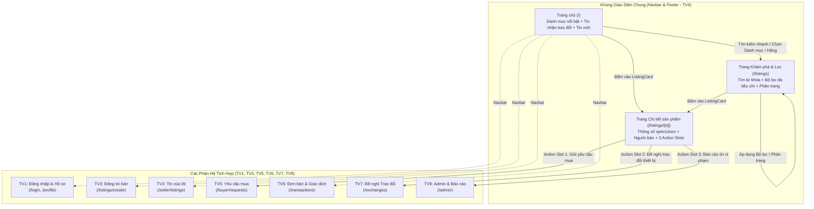

# SRS — Design System & Module Khám Phá, Tìm Kiếm, Lọc (TV4)

**Phiên bản:** 1.0 · **Học phần:** Nhập môn Công nghệ phần mềm (IT3180) — Nhóm 5  
**Người phụ trách:** Thành viên 4 (Mũ 1: UI/UX Lead · Mũ 2: Module Discovery)

---

## 1. MỤC TIÊU & PHẠM VI

### 1.1 Mục tiêu Mũ 1 — UI/UX Lead (Design System & Shared Layout)
- Thiết lập **Bộ quy chuẩn Giao diện (Design System)** thống nhất với tông màu **Indigo / Slate** chuyên nghiệp cho sàn thương mại điện tử thiết bị công nghệ **ElectroSwap C2C**.
- Xây dựng **Shared Layout (`Navbar`, `Footer`, `Container`)** tích hợp sẵn toàn bộ đường dẫn điều hướng của 8 thành viên và tạo các **Trang khung (Placeholder Pages)** cho TV1, TV3, TV5, TV6, TV7, TV8 để các thành viên làm việc độc lập không phát sinh xung đột Git (`Merge Conflict`).
- Cung cấp **Bộ UI Components dùng chung (`ListingCard`, `StatusBadge`, `PriceText`, `Button`, `Card`, `EmptyState`, `Pagination`)** ánh xạ trực tiếp với các hằng số trạng thái trong `src/lib/constants.ts`.

### 1.2 Mục tiêu Mũ 2 — Module Khám phá, Tìm kiếm & Lọc (Discovery)
- Hiển thị **Trang chủ (`/`)** và **Trang danh sách sản phẩm (`/listings`)** truy vấn trực tiếp từ Prisma SQLite Database.
- Cung cấp **Tìm kiếm theo từ khóa (`q`)** và **Bộ lọc đa tiêu chí** (Danh mục `category`, Thương hiệu `brand`, Tình trạng `condition`, Khoảng giá `minPrice` – `maxPrice`, Nhận trao đổi `allowExchange`, Sắp xếp `sort`, Phân trang `page`).
- Xây dựng **Trang chi tiết sản phẩm (`/listings/[id]`)** chuẩn hóa bảng thông số kỹ thuật (`specsJson`), thông tin người bán và thiết kế sẵn **3 Vùng nút bấm (Action Slots)** cho:
  - **TV5:** Gửi yêu cầu mua (`PurchaseRequest`)
  - **TV7:** Đề nghị trao đổi thiết bị (`ExchangeOffer`)
  - **TV8:** Báo cáo tin vi phạm (`Report`)

---

## 2. QUY CHUẨN GIAO DIỆN (DESIGN SYSTEM — ELECTROSWAP C2C)

### 2.1 Bảng màu chủ đạo (Color Tokens trong `src/app/globals.css`)

| Token CSS | Mã màu Hex | Vai trò hiển thị |
|---|---|---|
| `--background` | `#f8fafc` (Slate 50) | Nền tổng thể của ứng dụng, tạo độ tương phản dịu mắt cho các thẻ trắng |
| `--surface` | `#ffffff` (White) | Nền của `ListingCard`, bảng thông số, khung bộ lọc |
| `--foreground` | `#0f172a` (Slate 900) | Màu chữ chính, thanh `Navbar` và `Footer` |
| `--primary` | `#4f46e5` (Indigo 600) | Màu thương hiệu chính, nút hành động Mua, liên kết điều hướng, giá bán |
| `--exchange` | `#7c3aed` (Violet 600) | Màu nhận diện riêng cho luồng **Trao đổi thiết bị (Swap / Trade-in)** |
| `--success` | `#16a34a` (Emerald 600) | Trạng thái `ACTIVE`, `COMPLETED`, `ACCEPTED`, tình trạng `NEW` |
| `--warning` | `#d97706` (Amber 600) | Trạng thái chờ duyệt/xử lý (`PENDING`), tình trạng `FAIR` |
| `--danger` | `#dc2626` (Rose 600) | Trạng thái `REJECTED`, `LOCKED`, nút Báo cáo vi phạm |

### 2.2 Quy chuẩn `StatusBadge` thống nhất toàn sàn

Mọi trạng thái của 5 thực thể chính (`Listing`, `PurchaseRequest`, `ExchangeOffer`, `Transaction`, `Report`) đều được hiển thị qua `<StatusBadge status={...} entity={...} />`:

| Thực thể (`entity`) | Giá trị trạng thái | Nhãn hiển thị Tiếng Việt | Tông màu (`BadgeTone`) |
|---|---|---|---|
| `listing` | `PENDING` | Chờ duyệt | `warning` (Amber) |
| `listing` | `ACTIVE` | Đang bán | `success` (Emerald) |
| `listing` | `IN_TRANSACTION` | Đang giao dịch | `info` (Indigo) |
| `listing` | `SOLD` | Đã bán | `neutral` (Slate) |
| `listing` | `EXCHANGED` | Đã trao đổi | `exchange` (Violet) |
| `listing` | `REJECTED` | Bị từ chối | `danger` (Rose) |
| `listing` | `HIDDEN` | Đã ẩn | `neutral` (Slate) |
| `purchaseRequest` | `PENDING` / `ACCEPTED` / `REJECTED` / `CANCELLED` | Chờ người bán phản hồi / Đã chấp nhận mua / Từ chối yêu cầu / Đã huỷ yêu cầu | `warning` / `success` / `danger` / `neutral` |
| `exchangeOffer` | `PENDING` / `ACCEPTED` / `REJECTED` / `CANCELLED` | Chờ duyệt đổi máy / Đồng ý trao đổi / Từ chối trao đổi / Đã huỷ đề nghị | `warning` / `exchange` / `danger` / `neutral` |
| `transaction` | `IN_PROGRESS` / `COMPLETED` / `CANCELLED` | Đang giao dịch / Giao dịch hoàn tất / Giao dịch đã huỷ | `info` / `success` / `danger` |
| `report` | `PENDING` / `RESOLVED` / `DISMISSED` | Chờ xử lý báo cáo / Đã xử lý vi phạm / Bác bỏ báo cáo | `warning` / `success` / `neutral` |
| `condition` | `NEW` / `LIKE_NEW` / `GOOD` / `FAIR` | Mới 100% / Như mới / Tốt / Đã qua sử dụng | `success` / `info` / `neutral` / `warning` |

### 2.3 Quy chuẩn Thẻ sản phẩm (`ListingCard`)
- Tỷ lệ ảnh tiêu chuẩn `aspect-[4/3]`, tự động fallback về `/images/placeholder-device.svg` nếu `imagesJson` rỗng hoặc lỗi.
- Góc trên trái hiển thị `<StatusBadge entity="condition" />` (Mới 100% / Như mới / Tốt / Đã qua sử dụng).
- Góc trên phải hiển thị nhãn nổi bật **`🔄 Nhận trao đổi`** (nền Violet `#7c3aed`) khi `allowExchange === true`.
- Phần thân hiển thị danh mục (`category.name`), thương hiệu (`brand.name`), tiêu đề tối đa 2 dòng (`line-clamp-2`), gợi ý thiết bị muốn đổi (`exchangePreference`) và giá bán định dạng số nguyên VNĐ (`25.900.000 ₫`).

---

## 3. SƠ ĐỒ LUỒNG MÀN HÌNH (SCREEN FLOW)

---

## 4. ACTOR LIÊN QUAN

| Actor | Vai trò trong Module Discovery |
|---|---|
| **Guest (Khách vãng lai)** | Xem Trang chủ, tìm kiếm theo từ khóa, lọc đa tiêu chí, xem chi tiết sản phẩm và bảng thông số kỹ thuật (`specsJson`). |
| **Registered User (Người mua / Người trao đổi)** | Thực hiện tất cả chức năng của Guest và tương tác với 3 vùng Action Slots trên trang chi tiết để gửi yêu cầu mua (TV5), đề nghị trao đổi (TV7) hoặc báo cáo tin vi phạm (TV8). |
| **Developer (7 thành viên còn lại)** | Tái sử dụng `Navbar`, `Footer`, `ListingCard`, `StatusBadge`, `Button`, `EmptyState` và gắn logic vào các trang khung / Action Slots. |

---

## 5. ĐẶC TẢ USE CASE CHI TIẾT

### UC-DISC-01: Tìm kiếm thiết bị theo từ khóa

- **Actor:** Guest, Registered User, Admin
- **Tiền điều kiện:** Cơ sở dữ liệu SQLite đã được khởi tạo và có dữ liệu danh mục, thương hiệu, tin đăng.
- **Luồng sự kiện chính (Basic Flow):**
  1. Người dùng nhập từ khóa (ví dụ: `"iPhone 15"`, `"MacBook"`, `"RTX 4060"`) vào thanh tìm kiếm trên `Navbar`, Trang chủ (`/`) hoặc cột bộ lọc tại `/listings` rồi nhấn **Tìm kiếm**.
  2. Hệ thống điều hướng đến `/listings?q=<từ-khóa>`.
  3. Server Component gọi hàm `searchActiveListings` truy vấn các bản ghi `Listing` thỏa mãn đồng thời:
     - `status === "ACTIVE"` (kiểm tra qua luật hiển thị công khai).
     - Từ khóa xuất hiện trong `title`, `description`, `exchangePreference`, `brand.name` hoặc `category.name`.
  4. Hệ thống hiển thị số lượng kết quả tìm được và danh sách `<ListingCard />` tương ứng.
- **Luồng thay thế / Ngoại lệ (Alternative / Exception Flows):**
  - **E1 — Từ khóa rỗng hoặc chỉ chứa khoảng trắng:** Hệ thống tự động loại bỏ khoảng trắng thừa (`trim`) và hiển thị toàn bộ danh sách thiết bị đang `ACTIVE`.
  - **E2 — Không có thiết bị nào khớp từ khóa:** Hệ thống hiển thị component `<EmptyState />` thông báo *"Không tìm thấy thiết bị phù hợp với bộ lọc"* kèm nút **"Xem toàn bộ thiết bị"** để đặt lại bộ lọc.
- **Hậu điều kiện:** Không làm thay đổi dữ liệu trong CSDL.

---

### UC-DISC-02: Lọc và sắp xếp sản phẩm đa tiêu chí

- **Actor:** Guest, Registered User, Admin
- **Tiền điều kiện:** Người dùng đang ở trang `/listings` hoặc chọn danh mục/thương hiệu từ Trang chủ (`/`).
- **Luồng sự kiện chính (Basic Flow):**
  1. Người dùng chọn một hoặc nhiều tiêu chí lọc trên `DiscoveryFilterBar`:
     - **Danh mục (`category`):** Điện thoại, Laptop, Máy tính bảng, Tai nghe & Đồng hồ, Linh kiện & Phụ kiện.
     - **Thương hiệu (`brand`):** Apple, Samsung, Dell, Asus, Sony, Xiaomi.
     - **Tình trạng (`condition`):** `NEW` (Mới 100%), `LIKE_NEW` (Như mới), `GOOD` (Tốt), `FAIR` (Đã qua sử dụng).
     - **Khoảng giá (`minPrice`, `maxPrice`):** Nhập số tiền VNĐ hoặc chọn mức giá gợi ý nhanh.
     - **Nhận trao đổi (`allowExchange`):** Đánh dấu *"Chỉ hiện máy nhận trao đổi"*.
     - **Thứ tự sắp xếp (`sort`):** Mới đăng gần nhất (`newest`), Giá thấp đến cao (`price_asc`), Giá cao đến thấp (`price_desc`).
  2. Người dùng nhấn nút **Áp dụng bộ lọc**.
  3. Hệ thống chuẩn hóa tham số qua `normalizeDiscoverySearchParams`, truy vấn Prisma và hiển thị danh sách thẻ sản phẩm kèm các nhãn tiêu chí đang áp dụng (Active Filter Chips) và thanh phân trang `<Pagination />`.
- **Luồng thay thế / Ngoại lệ (Alternative / Exception Flows):**
  - **E1 — Người dùng nhập `minPrice > maxPrice`:** Hàm `normalizeDiscoverySearchParams` tự động hoán đổi hai giá trị để truy vấn khoảng giá hợp lệ thay vì trả về mảng rỗng do lỗi nhập liệu.
  - **E2 — Tham số `condition` hoặc `page` trên URL không hợp lệ (ví dụ `?condition=INVALID&page=-5`):** Hệ thống tự động bỏ qua `condition` sai và đưa `page` về mặc định `1`.
  - **E3 — Người dùng bấm "Đặt lại" hoặc "Xoá tất cả bộ lọc":** Hệ thống xóa toàn bộ query string, quay về `/listings` mặc định.
- **Hậu điều kiện:** URL phản ánh chính xác trạng thái bộ lọc hiện tại (có thể chia sẻ đường dẫn).

---

### UC-DISC-03: Xem chi tiết sản phẩm, bảng thông số kỹ thuật (`specsJson`) & Action Slots

- **Actor:** Guest, Registered User, Admin
- **Tiền điều kiện:** Người dùng bấm vào một thẻ `<ListingCard />` hoặc truy cập trực tiếp `/listings/[id]`.
- **Luồng sự kiện chính (Basic Flow):**
  1. Hệ thống nhận `id` từ URL và gọi `getListingDetailById(id)`.
  2. Hệ thống giải mã chuỗi JSON `specsJson` và `imagesJson` thông qua `parseSpecsJson` và `parseImagesJson`.
  3. Hệ thống hiển thị trang chi tiết gồm:
     - Hình ảnh thiết bị, nhãn `<StatusBadge />` của tình trạng máy và trạng thái tin đăng.
     - Giá bán định dạng VNĐ, nhãn "Nhận trao đổi" và ghi chú `exchangePreference` (nếu `allowExchange = true`).
     - **Bảng thông số kỹ thuật chuẩn hóa** (chuyển đổi khóa tiếng Anh như `screen`, `chip`, `ram`, `storage`, `battery` sang nhãn tiếng Việt).
     - Thông tin người bán (`fullName`, `phone` — tuyệt đối không truy vấn `passwordHash`).
     - **3 Vùng nút bấm (Action Slots):**
       - **Slot 1 (TV5):** Nút *"Gửi yêu cầu mua"* (`data-slot="tv5-purchase-action"`).
       - **Slot 2 (TV7):** Nút *"Đề nghị trao đổi thiết bị"* (`data-slot="tv7-exchange-action"`).
       - **Slot 3 (TV8):** Nút *"Báo cáo tin vi phạm"* (`data-slot="tv8-report-action"`).
     - Danh sách tối đa 4 thiết bị tương tự cùng danh mục đang ở trạng thái `ACTIVE`.
- **Luồng thay thế / Ngoại lệ (Alternative / Exception Flows):**
  - **E1 — `id` không tồn tại hoặc tin đăng đang ở trạng thái `PENDING`, `HIDDEN`, `REJECTED`:** Hệ thống không tiết lộ nội dung tin mà hiển thị `<EmptyState />` thông báo *"Không tìm thấy tin đăng hoặc thiết bị đã bị ẩn"* kèm nút quay lại `/listings`.
  - **E2 — Tin đăng có `allowExchange = false`:** Nút *"Đề nghị trao đổi thiết bị"* tại Action Slot 2 tự động chuyển sang trạng thái vô hiệu hóa (`disabled`) kèm chú thích người bán chỉ nhận bán thẳng.
  - **E3 — Tin đăng đang `IN_TRANSACTION`, `SOLD` hoặc `EXCHANGED`:** Cả 2 nút *"Gửi yêu cầu mua"* và *"Đề nghị trao đổi thiết bị"* đều bị khóa (`disabled`) kèm cảnh báo thiết bị không còn khả dụng để giao dịch mới.
  - **E4 — `specsJson` bị null hoặc sai cú pháp JSON:** Hàm `parseSpecsJson` bắt ngoại lệ an toàn và hiển thị thông báo *"Người bán chưa bổ sung thông số kỹ thuật chi tiết"*.
- **Hậu điều kiện:** Người dùng nắm rõ thông tin thiết bị và sẵn sàng chuyển tiếp sang luồng Mua (TV5), Trao đổi (TV7) hoặc Báo cáo (TV8).

---

## 6. YÊU CẦU CHỨC NĂNG (FR) & PHI CHỨC NĂNG (NFR)

| Mã | Loại | Nội dung yêu cầu | Mức độ |
|---|---|---|---|
| **FR-4.01** | Layout | `Navbar` hiển thị Logo ElectroSwap C2C, ô tìm kiếm nhanh và đủ liên kết tới 8 phân hệ của nhóm | Bắt buộc |
| **FR-4.02** | UI Kit | `ListingCard` và `StatusBadge` hiển thị đồng nhất dữ liệu thiết bị và toàn bộ trạng thái hệ thống | Bắt buộc |
| **FR-4.03** | Discovery | Trang chủ (`/`) và Trang danh sách (`/listings`) chỉ hiển thị công khai các tin có `status = ACTIVE` | Bắt buộc |
| **FR-4.04** | Discovery | Hỗ trợ lọc kết hợp theo Từ khóa, Danh mục, Thương hiệu, Tình trạng, Khoảng giá, Nhận trao đổi | Bắt buộc |
| **FR-4.05** | Detail | Trang chi tiết (`/listings/[id]`) hiển thị bảng thông số kỹ thuật từ `specsJson` và 3 vùng Action Slots (TV5, TV7, TV8) | Bắt buộc |
| **NFR-4.01** | Bảo mật | Tuyệt đối không truy vấn hoặc trả về trường `passwordHash` của `User` trong mọi câu lệnh Prisma | Bắt buộc |
| **NFR-4.02** | Kiến trúc | Chỉ sử dụng Prisma singleton từ `@/lib/prisma` trong Server Component, không gọi trong Client Component | Bắt buộc |
| **NFR-4.03** | Chất lượng | TypeScript `strict: true`, không sử dụng `any`, giao diện hỗ trợ Responsive trên Mobile, Tablet và Desktop | Bắt buộc |

---

## 7. TIÊU CHÍ CHẤP NHẬN (ACCEPTANCE CRITERIA) & TRUY VẾT

| Mã AC | Kịch bản kiểm chứng | File hiện thực | File kiểm thử |
|---|---|---|---|
| **AC-4.01** | `StatusBadge` trả về đúng nhãn tiếng Việt và màu sắc cho tất cả trạng thái của `Listing`, `PurchaseRequest`, `ExchangeOffer`, `Transaction`, `Report` | `src/components/ui/StatusBadge.tsx` | `tests/discovery.test.ts` |
| **AC-4.02** | `searchActiveListings` chỉ trả về các tin `ACTIVE` (loại bỏ `PENDING`, `SOLD`, `HIDDEN`, `REJECTED`) | `src/features/discovery/queries.ts` | `tests/discovery.test.ts` |
| **AC-4.03** | Lọc theo `category`, `brand`, `condition`, `minPrice`/`maxPrice`, `allowExchange=true` và từ khóa `q` trả về đúng tập sản phẩm từ DB seed | `src/features/discovery/queries.ts`, `src/app/listings/page.tsx` | `tests/discovery.test.ts` |
| **AC-4.04** | Xem chi tiết tin `ACTIVE` (`lst-iphone15pm`) trả về đủ thông số `specs`, thông tin người bán (không có `passwordHash`); xem tin `PENDING` (`lst-tab-s9`) hoặc ID không tồn tại trả về `null` | `src/features/discovery/queries.ts`, `src/app/listings/[id]/page.tsx` | `tests/discovery.test.ts` |
